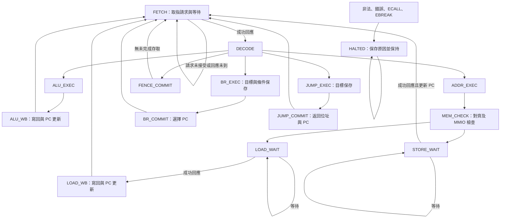

# control fsm架構

**① 模組用途與規格**

Control FSM 根據 Decoder 的分類與記憶體回應，把一條指令拆成多個 clock cycle，產生資料路徑的寫入允許、記憶體握手與錯誤停止控制。

| 項目 | 規格 |
| --- | --- |
| 模組名稱 | control_fsm |
| 核心執行方式 | 32-bit、多周期、一次一條指令、依序完成 |
| Clock | 單一 clock，上升緣更新 |
| Reset | 高有效、同步重置狀態與除錯暫存器；rst 高時組合控制輸出立即停用 |
| 狀態 | 15 個狀態，內部控制型別為 4-bit |
| 記憶體介面 | 指令／資料分離的 request／response 握手 |
| 未完成交易數 | 全核心最多一筆 |
| PC 更新 | 只在指令正常完成時更新 |
| 錯誤策略 | 阻擋該指令提交，保存原因與位址，進入 HALTED |
| 恢復方式 | Reset |
| 硬體 timeout | 本版沒有；外部不回應時維持等待 |

Decoder 的 rd_write 表示「需要寫回」；FSM 的 reg_we 表示「這一拍允許寫回」。兩者不能直接混用。

---

**② 模組責任與資料保存**

| 位置 | 保存／處理內容 |
| --- | --- |
| FSM 內部 | State、mem_pending、halt_cause、fault_pc、fault_addr |
| 外部 PC | 下一次取指地址；正常提交時才更新 |
| 外部 IR／InstrPC | 目前指令與它的原始地址；成功取指時同時保存 |
| 外部 A／B | Decode 階段保存 Register File 的兩個讀取值 |
| 外部 ALUOut | Execute 階段保存運算結果、有效位址或處理後跳躍目標 |
| 外部 BranchTaken | BR_EXEC 階段保存比較器結果 |
| 外部 MDR | 成功 Load 回應時保存原始對齊 word |
| 外部 Load／Store 處理 | byte 擷取與擴展、Store 資料移位與四位元 byte enable |

本版對齊與初始 MMIO 存取寬度檢查放在 FSM 的 MEM_CHECK，和請求控制一起判斷。ALU、位址加法、分支比較與資料擴展仍在資料路徑。

IR、InstrPC 與 Decoder 輸出在指令執行期間保持不變。ALUOut、BranchTaken、A、B、MDR 都必須由對應 enable 更新，不能每拍無條件覆寫。

---

**③ 輸入介面**

| 訊號 | 寬度／型別 | 說明 |
| --- | --- | --- |
| clk／rst | 各 1-bit | Clock 與高有效 reset |
| instr_class | instr_class_t／4-bit | Decoder 分類 |
| illegal | 1-bit | Decoder 判定非法／未支援 |
| rd_write | 1-bit | Decoder 的寫回需求 |
| mem_size | mem_size_t／2-bit | Byte／Halfword／Word |
| pc | 32-bit | 目前取指位址 |
| instr_pc | 32-bit | IR 這條指令的位址 |
| mem_addr | 32-bit | ALUOut 保存的原始資料有效位址 |
| target_addr | 32-bit | ALUOut 保存的目標；JALR 已在外部清除 bit 0 |
| branch_taken | 1-bit | BranchTaken 暫存器的值 |
| imem_req_ready | 1-bit | 指令端接受請求 |
| imem_rsp_valid／imem_rsp_err | 各 1-bit | 指令回應有效／錯誤 |
| dmem_req_ready | 1-bit | 資料端接受請求 |
| dmem_rsp_valid／dmem_rsp_err | 各 1-bit | 資料回應有效／錯誤 |

指令與讀回資料直接送往外部 IR／MDR，不經由 control_fsm 的資料輸入埠。Decoder 的 alu_op、imm_sel、輸入來源與 wb_sel 也直接接到資料路徑；FSM 產生更新時機。

---

**④ 輸出介面**

| 訊號 | 寬度／型別 | 說明 |
| --- | --- | --- |
| imem_req_valid | 1-bit | 取指請求有效 |
| imem_req_addr | 32-bit | PC，不進行額外地址轉換 |
| imem_rsp_ready | 1-bit | 接受目前取指回應 |
| dmem_req_valid | 1-bit | 資料請求有效 |
| dmem_req_addr | 32-bit | mem_addr 清除低兩位後的對齊 word 地址 |
| dmem_req_write | 1-bit | 資料交易為 Store；只在 req_valid 有效時使用 |
| dmem_rsp_ready | 1-bit | 接受目前資料回應 |
| ir_we／instr_pc_we | 各 1-bit | 同一拍保存指令與取指 PC |
| ab_we | 1-bit | 同一拍保存兩個讀取運算元 |
| aluout_we | 1-bit | 保存 ALU／JALR 處理後結果 |
| branch_taken_we | 1-bit | 保存分支條件 |
| mdr_we | 1-bit | 保存成功 Load 回應 |
| reg_we | 1-bit | 接 Register File 的 rd_we |
| pc_we | 1-bit | 接 PC 暫存器的更新允許 |
| pc_sel | pc_sel_t／1-bit | PC_SEQ＝InstrPC＋4；PC_TARGET＝ALUOut |
| instr_done | 1-bit | 該指令在這個上升緣正常完成；本版等於 pc_we |
| state | cpu_state_t／4-bit | 供模擬與除錯觀察 |
| mem_pending | 1-bit | 已接受請求，尚未接受完成回應 |
| halted | 1-bit | State＝HALTED |
| halt_cause | halt_cause_t／4-bit | 保存的停止原因 |
| fault_pc／fault_addr | 各 32-bit | 保存的指令位址／相關地址 |

dmem_req_wdata 與 dmem_req_wstrb 由 Store 對齊邏輯產生。Store 請求等待時，這兩個訊號必須和地址、write 一樣保持穩定。

---

**⑤ 共用狀態與編碼：fault_v_pkg.sv**

以下保留既有 ALU、IMM 與 Decoder 編碼，加入 FSM 狀態、PC 選擇與停止原因。專案只使用一份同名 package。

```verilog
`timescale 1ns/1ps
package fault_v_pkg;
    typedef enum logic [3:0] {
        ALU_ADD=4'd0, ALU_SUB=4'd1, ALU_AND=4'd2, ALU_OR=4'd3,
        ALU_XOR=4'd4, ALU_SLL=4'd5, ALU_SRL=4'd6, ALU_SRA=4'd7,
        ALU_SLT=4'd8, ALU_SLTU=4'd9
    } alu_op_t;
    typedef enum logic [2:0] {
        IMM_NONE=3'd0, IMM_I=3'd1, IMM_S=3'd2,
        IMM_B=3'd3, IMM_U=3'd4, IMM_J=3'd5
    } imm_sel_t;
    typedef enum logic [3:0] {
        IC_INVALID=4'd0, IC_ALU=4'd1, IC_LOAD=4'd2, IC_STORE=4'd3,
        IC_BRANCH=4'd4, IC_JAL=4'd5, IC_JALR=4'd6,
        IC_FENCE=4'd7, IC_ECALL=4'd8, IC_EBREAK=4'd9
    } instr_class_t;
    typedef enum logic [1:0] {
        ALU_A_REG=2'd0, ALU_A_PC=2'd1, ALU_A_ZERO=2'd2
    } alu_src_a_t;
    typedef enum logic { ALU_B_REG=1'b0, ALU_B_IMM=1'b1 } alu_src_b_t;
    typedef enum logic [2:0] {
        BR_NONE=3'd0, BR_EQ=3'd1, BR_NE=3'd2, BR_LT=3'd3,
        BR_GE=3'd4, BR_LTU=3'd5, BR_GEU=3'd6
    } branch_op_t;
    typedef enum logic [1:0] {
        MEM_BYTE=2'd0, MEM_HALF=2'd1, MEM_WORD=2'd2
    } mem_size_t;
    typedef enum logic [1:0] {
        WB_ALU=2'd0, WB_LOAD=2'd1, WB_PC4=2'd2
    } wb_sel_t;
    typedef enum logic [3:0] {
        ST_FETCH=4'd0, ST_DECODE=4'd1, ST_ALU_EXEC=4'd2,
        ST_ALU_WB=4'd3, ST_ADDR_EXEC=4'd4, ST_MEM_CHECK=4'd5,
        ST_LOAD_WAIT=4'd6, ST_LOAD_WB=4'd7, ST_STORE_WAIT=4'd8,
        ST_BR_EXEC=4'd9, ST_BR_COMMIT=4'd10, ST_JUMP_EXEC=4'd11,
        ST_JUMP_COMMIT=4'd12, ST_FENCE_COMMIT=4'd13, ST_HALTED=4'd14
    } cpu_state_t;
    typedef enum logic { PC_SEQ=1'b0, PC_TARGET=1'b1 } pc_sel_t;
    typedef enum logic [3:0] {
        HALT_NONE=4'd0, HALT_ILLEGAL=4'd1, HALT_INSTR_ALIGN=4'd2,
        HALT_FETCH_ACCESS=4'd3, HALT_LOAD_ALIGN=4'd4, HALT_STORE_ALIGN=4'd5,
        HALT_LOAD_ACCESS=4'd6, HALT_STORE_ACCESS=4'd7,
        HALT_ECALL=4'd8, HALT_EBREAK=4'd9, HALT_INTERNAL=4'd10
    } halt_cause_t;
endpackage
```

---

**⑥ 狀態圖**



任一錯誤路徑依下一節規則轉至 HALTED；圖中的 ERROR 是說明節點，不是額外的 RTL 狀態。Reset 後回到 FETCH。

---

**⑦ 逐狀態控制表**

未列出的 enable 皆為 0。所有動作在 clock 上升緣生效，條件滿足時才啟用。

| 狀態 | 有效動作 | 轉移條件／下一狀態 |
| --- | --- | --- |
| FETCH，pending＝0 | 對齊且非 reset 時 imem_req_valid＝1 | req_valid＆req_ready：pending＝1，仍在 FETCH |
| FETCH，pending＝1 | imem_rsp_ready＝1 | 成功回應：ir_we、instr_pc_we＝1，pending＝0 → DECODE；失敗 → HALTED |
| DECODE | 運算／存取／分支／跳躍時 ab_we＝1 | 按 instr_class 分流；illegal 優先停止 |
| ALU_EXEC | aluout_we＝1 | → ALU_WB |
| ALU_WB | reg_we＝rd_write、pc_we＝1、PC_SEQ、instr_done＝1 | → FETCH |
| ADDR_EXEC | aluout_we＝1 | → MEM_CHECK |
| MEM_CHECK | 檢查原始有效位址，不發請求 | 合法 Load → LOAD_WAIT；合法 Store → STORE_WAIT；錯誤 → HALTED |
| LOAD_WAIT，pending＝0 | dmem_req_valid＝1、write＝0 | 請求接受後 pending＝1，保持 |
| LOAD_WAIT，pending＝1 | dmem_rsp_ready＝1 | 成功：mdr_we＝1、pending＝0 → LOAD_WB；失敗 → HALTED |
| LOAD_WB | reg_we＝rd_write、pc_we＝1、PC_SEQ、instr_done＝1 | → FETCH |
| STORE_WAIT，pending＝0 | dmem_req_valid＝1、write＝1 | 請求接受後 pending＝1，保持 |
| STORE_WAIT，pending＝1 | dmem_rsp_ready＝1 | 成功：pending＝0、pc_we＝1、PC_SEQ、instr_done＝1 → FETCH；失敗 → HALTED |
| BR_EXEC | aluout_we、branch_taken_we＝1 | → BR_COMMIT |
| BR_COMMIT | 未錯誤時 pc_we、instr_done＝1；不寫回 RF | 成立選 PC_TARGET；不成立選 PC_SEQ → FETCH |
| JUMP_EXEC | aluout_we＝1 | → JUMP_COMMIT |
| JUMP_COMMIT | 目標對齊時 reg_we＝rd_write、pc_we＝1、PC_TARGET、instr_done＝1 | → FETCH；未對齊 → HALTED |
| FENCE_COMMIT | pending＝0 時 pc_we、instr_done＝1、PC_SEQ | → FETCH；否則等待 |
| HALTED | 不再發請求、不接受新回應、不寫入資料路徑 | 保持；Reset 恢復 |

錯誤回應發生的當拍仍保留該回應通道的 rsp_ready，先把錯誤回應接受完，清除 pending，再在上升緣進入 HALTED。

---

**⑧ 記憶體握手與等待規則**

| 項目 | 規則 |
| --- | --- |
| 請求接受 | req_valid＆req_ready 在上升緣同為 1 |
| 等待接受 | req_valid 保持 1；請求內容保持穩定 |
| 已接受請求 | mem_pending＝1；req_valid 轉為 0 |
| 回應接受 | 對應 rsp_valid＆rsp_ready 在上升緣同為 1 |
| 回應等待 | 記憶體端保持 rsp_valid、data、err，直到回應被接受 |
| 完成回應 | 包含 Store 的成功／失敗回應；不是只有 Load 才要回應 |
| 同一邊緣請求與回應 | 本控制器不在請求接受的同一個邊緣接受該筆回應 |
| 無已接受請求時的回應 | rsp_ready＝0，不接受 |
| 通道所有權 | FETCH 只接受指令回應；LOAD_WAIT／STORE_WAIT 只接受資料回應 |
| 重送 | 成功或失敗回應後皆不自動重送 |

```
                請求尚未被接受       已接受，等待回應       回應被接受
req_valid           1  1  1                 0                    0
req_ready           0  0  1                 X                    X
mem_pending         0  0  0                 1              下一拍變 0
rsp_ready           0  0  0                 1                    1
rsp_valid           0  0  0             0 ... 0                    1
```

X 表示本次請求完成接受後，不再使用 req_ready 的值。回應若提早出現，也必須保持到 rsp_ready 為 1，不能只送一個未被接受的脈衝。

mem_pending 和狀態一起保存，因此 response valid 不能被當成「每拍都可執行的寫回事件」。控制器只在正確等待狀態接受一次。

---

**⑨ PC、寫回與提交規則**

| 指令／情況 | 更新 PC | 寫回 RF |
| --- | --- | --- |
| 運算指令 | ALU_WB：InstrPC＋4 | ALUOut |
| Load | LOAD_WB：InstrPC＋4 | MDR 擷取／擴展後資料 |
| Store | 成功完成回應的邊緣：InstrPC＋4 | 無 |
| Branch 不成立 | BR_COMMIT：InstrPC＋4 | 無 |
| Branch 成立且目標對齊 | BR_COMMIT：ALUOut | 無 |
| JAL／JALR 目標對齊 | JUMP_COMMIT：ALUOut | InstrPC＋4 |
| FENCE | FENCE_COMMIT：InstrPC＋4 | 無 |
| 等待／錯誤／ECALL／EBREAK | 不更新 | 不寫入 |

instr_done 在正常完成的邊緣有效，用於測試計數；本版取指、Decode、Execute、等待以及停止都不令它有效。

rd＝x0 時 reg_we 可以為 1，Register File 會忽略該寫入。Load 到 x0 仍完整執行存取與錯誤處理。

---

**⑩ 對齊與 MMIO 規則**

| 存取 | 檢查 |
| --- | --- |
| 取指 | PC[1:0] 必須為 00，否則不發請求 |
| 採用的 Branch／Jump 目標 | target_addr[1:0] 必須為 00 |
| 未採用的 Branch 目標 | 不檢查目標對齊 |
| Byte | 任意有效位址低兩位皆可 |
| Halfword | mem_addr[0] 必須為 0 |
| Word | mem_addr[1:0] 必須為 00 |
| 初始 MMIO 頁 | 0x20000000～0x20000FFF，只允許 Word 存取 |

JALR 必須先在外部清除結果 bit 0，保存到 ALUOut，再由 JUMP_COMMIT 檢查是否滿足 4-byte 對齊。例如原始目標 0x103 清除後為 0x102，仍會停止。

MEM_CHECK 先判斷資料未對齊，再判斷 MMIO 寬度，所以 MMIO 的未對齊 halfword 優先回報未對齊原因。

對外 dmem_req_addr＝mem_addr＆0xFFFFFFFC。Load 擷取與 Store mask、資料移位仍使用原始 mem_addr[1:0]；fault_addr 也保存原始位址。

控制器不在這裡限制全部合法記憶體區域。除了已定義的窄 MMIO 禁止規則，未映射／唯讀／超出容量等存取由記憶體互連或周邊用 rsp_err 回報。改變記憶體配置時，應同步更新檢查規格。

---

**⑪ 停止原因與保存資訊**

| 原因 | 編碼 | fault_pc | fault_addr |
| --- | --- | --- | --- |
| NONE | 0 | Reset 清 0 | Reset 清 0 |
| ILLEGAL | 1 | InstrPC | 0 |
| INSTR_ALIGN：取指 | 2 | PC | PC |
| INSTR_ALIGN：Branch／Jump | 2 | InstrPC | 處理後目標 |
| FETCH_ACCESS | 3 | PC | PC |
| LOAD_ALIGN | 4 | InstrPC | 原始 mem_addr |
| STORE_ALIGN | 5 | InstrPC | 原始 mem_addr |
| LOAD_ACCESS | 6 | InstrPC | 原始 mem_addr |
| STORE_ACCESS | 7 | InstrPC | 原始 mem_addr |
| ECALL | 8 | InstrPC | 0 |
| EBREAK | 9 | InstrPC | 0 |
| INTERNAL | 10 | InstrPC | 0 |

INTERNAL 是額外的控制器診斷值，用於無效狀態或 MEM_CHECK 中不符合預期的指令分類；原有原因的 0～9 編碼保留。這個預設分支不等於已具備硬體故障容錯能力。

Debug 資訊在進入 HALTED 的上升緣保存，之後保持到 Reset。HALTED 中輸入改變不會繼續執行，也不會覆寫停止原因。

Store 被接受後，外部可能已產生副作用。失敗回應或 reset 不保證回復已寫入記憶體／周邊的狀態，控制器不自動重試。

如果跳躍已經提交，下一次目標取指才失敗，錯誤屬於目標 PC；已寫入的返回位址會保留。

---

**⑫ Reset 與外部介面約定**

| 項目 | 行為／要求 |
| --- | --- |
| rst 拉高、邊緣尚未到 | State 與 debug 保存值暫時不變；請求、回應 ready 與寫入 enable 停用 |
| rst＝1 的上升緣 | State→FETCH、pending→0、停止資訊清 0 |
| PC／RF／資料路徑 | 必須使用同一個適當同步的 reset |
| 記憶體與周邊控制介面 | Reset 取消未完成的請求／回應追蹤，不再返回舊交易回應 |
| SRAM 内容／已發生副作用 | 不要求因 reset 自動回復 |
| Reset 解除 | 由重置後的 PC 重新取指 |

本介面沒有 transaction ID，不能區分 reset 前與 reset 後交易。外部橋接器若不能取消舊交易，必須在解除核心 reset 前先排空或隔離它們。

---

**⑬ 完整 RTL：control_fsm.sv**

```verilog
`timescale 1ns/1ps
module control_fsm (
    input logic clk, rst,
    // Decoder outputs. IR and decoded controls must stay stable until commit.
    input fault_v_pkg::instr_class_t instr_class,
    input logic illegal, rd_write,
    input fault_v_pkg::mem_size_t mem_size,
    // Datapath state: current fetch PC, instruction PC, raw data address,
    // and the already processed branch/jump target (JALR bit 0 cleared).
    input logic [31:0] pc, instr_pc, mem_addr, target_addr,
    input logic branch_taken,

    // Separate instruction and data request/response channels.
    output logic imem_req_valid,
    input logic imem_req_ready,
    output logic [31:0] imem_req_addr,
    input logic imem_rsp_valid, imem_rsp_err,
    output logic imem_rsp_ready,
    output logic dmem_req_valid,
    input logic dmem_req_ready,
    output logic dmem_req_write,
    output logic [31:0] dmem_req_addr,
    input logic dmem_rsp_valid, dmem_rsp_err,
    output logic dmem_rsp_ready,

    // Datapath enables, all sampled on rising edges.
    output logic ir_we, instr_pc_we, ab_we, aluout_we,
    output logic branch_taken_we, mdr_we, reg_we, pc_we,
    output fault_v_pkg::pc_sel_t pc_sel,
    output logic instr_done,

    // Observable state and sticky debug information.
    output fault_v_pkg::cpu_state_t state,
    output logic mem_pending, halted,
    output fault_v_pkg::halt_cause_t halt_cause,
    output logic [31:0] fault_pc, fault_addr
);
    import fault_v_pkg::*;
    cpu_state_t next_state;
    logic pending_next, halt_event, data_misaligned, narrow_mmio;
    halt_cause_t event_cause;
    logic [31:0] event_pc, event_addr;

    assign imem_req_addr=pc;
    assign dmem_req_addr={mem_addr[31:2],2'b00};
    assign halted=(state==ST_HALTED);

    always_comb begin
        data_misaligned=1'b0;
        case (mem_size)
            MEM_BYTE: data_misaligned=1'b0;
            MEM_HALF: data_misaligned=mem_addr[0];
            MEM_WORD: data_misaligned=|mem_addr[1:0];
            default: data_misaligned=1'b1;
        endcase
        // The agreed first MMIO page permits word accesses only.
        narrow_mmio=(mem_addr[31:12]==20'h20000) && (mem_size!=MEM_WORD);
    end

    always_comb begin
        next_state=state;
        pending_next=mem_pending;
        imem_req_valid=0; imem_rsp_ready=0;
        dmem_req_valid=0; dmem_req_write=0; dmem_rsp_ready=0;
        ir_we=0; instr_pc_we=0; ab_we=0; aluout_we=0;
        branch_taken_we=0; mdr_we=0; reg_we=0; pc_we=0;
        pc_sel=PC_SEQ; instr_done=0;
        halt_event=0; event_cause=HALT_NONE;
        event_pc=instr_pc; event_addr=0;

        case (state)
            ST_FETCH: begin
                if (!mem_pending) begin
                    if (pc[1:0]!=2'b00) begin
                        halt_event=1; event_cause=HALT_INSTR_ALIGN;
                        event_pc=pc; event_addr=pc;
                    end else begin
                        imem_req_valid=1;
                        if (imem_req_ready) pending_next=1;
                    end
                end else begin
                    imem_rsp_ready=1;
                    if (imem_rsp_valid) begin
                        pending_next=0;
                        if (imem_rsp_err) begin
                            halt_event=1; event_cause=HALT_FETCH_ACCESS;
                            event_pc=pc; event_addr=pc;
                        end else begin
                            ir_we=1; instr_pc_we=1; next_state=ST_DECODE;
                        end
                    end
                end
            end
            ST_DECODE: begin
                if (illegal) begin
                    halt_event=1; event_cause=HALT_ILLEGAL;
                end else begin
                    case (instr_class)
                        IC_ALU: begin ab_we=1; next_state=ST_ALU_EXEC; end
                        IC_LOAD, IC_STORE: begin ab_we=1; next_state=ST_ADDR_EXEC; end
                        IC_BRANCH: begin ab_we=1; next_state=ST_BR_EXEC; end
                        IC_JAL, IC_JALR: begin ab_we=1; next_state=ST_JUMP_EXEC; end
                        IC_FENCE: next_state=ST_FENCE_COMMIT;
                        IC_ECALL: begin halt_event=1; event_cause=HALT_ECALL; end
                        IC_EBREAK: begin halt_event=1; event_cause=HALT_EBREAK; end
                        default: begin halt_event=1; event_cause=HALT_ILLEGAL; end
                    endcase
                end
            end
            ST_ALU_EXEC: begin aluout_we=1; next_state=ST_ALU_WB; end
            ST_ALU_WB: begin
                reg_we=rd_write; pc_we=1; instr_done=1; next_state=ST_FETCH;
            end
            ST_ADDR_EXEC: begin aluout_we=1; next_state=ST_MEM_CHECK; end
            ST_MEM_CHECK: begin
                // Misalignment has priority over unsupported narrow MMIO.
                if (data_misaligned) begin
                    halt_event=1; event_addr=mem_addr;
                    if (instr_class==IC_LOAD) event_cause=HALT_LOAD_ALIGN;
                    else event_cause=HALT_STORE_ALIGN;
                end else if (narrow_mmio) begin
                    halt_event=1; event_addr=mem_addr;
                    if (instr_class==IC_LOAD) event_cause=HALT_LOAD_ACCESS;
                    else event_cause=HALT_STORE_ACCESS;
                end else if (instr_class==IC_LOAD) next_state=ST_LOAD_WAIT;
                else if (instr_class==IC_STORE) next_state=ST_STORE_WAIT;
                else begin halt_event=1; event_cause=HALT_INTERNAL; end
            end
            ST_LOAD_WAIT, ST_STORE_WAIT: begin
                dmem_req_write=(state==ST_STORE_WAIT);
                if (!mem_pending) begin
                    dmem_req_valid=1;
                    if (dmem_req_ready) pending_next=1;
                end else begin
                    dmem_rsp_ready=1;
                    if (dmem_rsp_valid) begin
                        pending_next=0;
                        if (dmem_rsp_err) begin
                            halt_event=1; event_addr=mem_addr;
                            if (state==ST_LOAD_WAIT) event_cause=HALT_LOAD_ACCESS;
                            else event_cause=HALT_STORE_ACCESS;
                        end else if (state==ST_LOAD_WAIT) begin
                            mdr_we=1; next_state=ST_LOAD_WB;
                        end else begin
                            pc_we=1; instr_done=1; next_state=ST_FETCH;
                        end
                    end
                end
            end
            ST_LOAD_WB: begin
                reg_we=rd_write; pc_we=1; instr_done=1; next_state=ST_FETCH;
            end
            ST_BR_EXEC: begin
                aluout_we=1; branch_taken_we=1; next_state=ST_BR_COMMIT;
            end
            ST_BR_COMMIT: begin
                if (branch_taken && (target_addr[1:0]!=2'b00)) begin
                    halt_event=1; event_cause=HALT_INSTR_ALIGN; event_addr=target_addr;
                end else begin
                    if (branch_taken) pc_sel=PC_TARGET;
                    pc_we=1; instr_done=1; next_state=ST_FETCH;
                end
            end
            ST_JUMP_EXEC: begin aluout_we=1; next_state=ST_JUMP_COMMIT; end
            ST_JUMP_COMMIT: begin
                if (target_addr[1:0]!=2'b00) begin
                    halt_event=1; event_cause=HALT_INSTR_ALIGN; event_addr=target_addr;
                end else begin
                    pc_sel=PC_TARGET; reg_we=rd_write;
                    pc_we=1; instr_done=1; next_state=ST_FETCH;
                end
            end
            ST_FENCE_COMMIT: begin
                if (!mem_pending) begin
                    pc_we=1; instr_done=1; next_state=ST_FETCH;
                end
            end
            ST_HALTED: begin end
            default: begin halt_event=1; event_cause=HALT_INTERNAL; end
        endcase

        if (halt_event) begin
            next_state=ST_HALTED;
            // An error response must still handshake before entering HALTED.
            imem_req_valid=0; dmem_req_valid=0;
            ir_we=0; instr_pc_we=0; ab_we=0; aluout_we=0;
            branch_taken_we=0; mdr_we=0; reg_we=0; pc_we=0; instr_done=0;
        end
        // Suppress external actions while reset is asserted; sequential reset
        // still takes effect only at the rising edge.
        if (rst) begin
            next_state=ST_FETCH; pending_next=0; halt_event=0;
            imem_req_valid=0; imem_rsp_ready=0;
            dmem_req_valid=0; dmem_req_write=0; dmem_rsp_ready=0;
            ir_we=0; instr_pc_we=0; ab_we=0; aluout_we=0;
            branch_taken_we=0; mdr_we=0; reg_we=0; pc_we=0; instr_done=0;
            pc_sel=PC_SEQ;
        end
    end

    always_ff @(posedge clk) begin
        if (rst) begin
            state<=ST_FETCH; mem_pending<=0;
            halt_cause<=HALT_NONE; fault_pc<=0; fault_addr<=0;
        end else begin
            state<=next_state; mem_pending<=pending_next;
            if (halt_event) begin
                halt_cause<=event_cause; fault_pc<=event_pc; fault_addr<=event_addr;
            end
        end
    end
endmodule
```

---

**⑭ 最短正常執行時序範例**

假設每個請求立即被接受，記憶體回應在下一個边緣接受。下面的 C1、C2 是連續 clock 上升緣，不是學習日期。

| 指令類別 | 邊緣上的動作 | 最短 cycle 數 |
| --- | --- | --- |
| ALU／LUI／AUIPC | C1 取指接受 → C2 IR 保存 → C3 A/B 保存 → C4 ALUOut 保存 → C5 寫回／PC | 5 |
| Branch | C1 取指 → C2 IR → C3 A/B → C4 目標／BranchTaken → C5 PC | 5 |
| JAL／JALR | C1 取指 → C2 IR → C3 A/B → C4 目標 → C5 返回位址／PC | 5 |
| Load | C1 取指 → C2 IR → C3 A/B → C4 有效位址 → C5 檢查 → C6 資料請求 → C7 MDR → C8 寫回／PC | 8 |
| Store | C1 取指 → C2 IR → C3 A/B → C4 有效位址 → C5 檢查 → C6 資料請求 → C7 成功回應／PC | 7 |
| FENCE | C1 取指 → C2 IR → C3 分類 → C4 確認無 pending／PC | 4 |

記憶體接受／回應每多等待一拍，執行時間就增加一拍。testbench 的記憶體模型可能額外註冊 ready，因此觀察到的時長不一定是這個最短值。

---

**⑮ 控制器單元驗證方法**

tb_control_fsm 直接提供 Decoder 分類與資料路徑狀態，核對 FSM 各狀態的 enable、轉移與停止資訊。

| 測試範圍 | 檢查內容 |
| --- | --- |
| 取指與資料等待 | 請求／回應延遲各 0～3，確認 pending 與請求只接受一次 |
| ALU、Load、Store | 正確分流、執行與提交 |
| Branch | 成立／不成立／未採用未對齊目標／採用未對齊目標 |
| Jump | JAL、JALR 的目標檢查與返回位址寫入允許 |
| 特殊／非法 | FENCE、ECALL、EBREAK、非法優先權 |
| 存取失敗 | 取指、Load、Store 的錯誤回應握手與 pending 清除 |
| 資料對齊與 MMIO | Halfword／Word 錯誤、窄 MMIO、錯誤優先順序與原始位址保存 |
| Reset | 自然到達所有 15 個狀態後重置；另外重置已接受的取指與資料交易 |
| HALTED | 保持停止、不產生後續寫入／請求、debug 不被外部輸入變更覆寫 |

獨立 monitor 以實際握手維護交易計數，確認 mem_pending 和它一致；也檢查地址在背壓期間不變、IR／MDR 只在成功回應時更新、RF 只在合法提交狀態寫入。

---

**⑯ 完整單元 Testbench：tb_control_fsm.sv**

```verilog
module tb_control_fsm;
    timeunit 1ns;
    timeprecision 1ps;
    import fault_v_pkg::*;
    logic clk=0, rst;
    always #5 clk=~clk;
    instr_class_t instr_class;
    logic illegal,rd_write;
    mem_size_t mem_size;
    logic [31:0] pc,instr_pc,mem_addr,target_addr;
    logic branch_taken;
    logic imem_req_valid,imem_req_ready,imem_rsp_valid,imem_rsp_err,imem_rsp_ready;
    logic [31:0] imem_req_addr;
    logic dmem_req_valid,dmem_req_ready,dmem_req_write,dmem_rsp_valid,dmem_rsp_err,dmem_rsp_ready;
    logic [31:0] dmem_req_addr;
    logic ir_we,instr_pc_we,ab_we,aluout_we,branch_taken_we,mdr_we,reg_we,pc_we,instr_done;
    pc_sel_t pc_sel;
    cpu_state_t state;
    logic mem_pending,halted;
    halt_cause_t halt_cause;
    logic [31:0] fault_pc,fault_addr;
    control_fsm dut(.*);
    int checks=0,cases=0;
    integer rq,rs,k,s;
    cpu_state_t wanted;
    instr_class_t chosen;
    logic score_pending=0,score_data=0;
    logic stalled_i=0,stalled_d=0;
    logic [31:0] held_i_addr,held_d_addr;
    logic held_d_write;

    task automatic must(input logic cond,input string label_text);
        if (cond !== 1'b1)
            $fatal(1,"FAIL %s state=%0d pending=%b",label_text,state,mem_pending);
        checks++;
    endtask
    task automatic tick;
        @(posedge clk); #1;
    endtask
    task automatic reset_all;
        @(negedge clk);
        rst=1; instr_class=IC_ALU; illegal=0; rd_write=1; mem_size=MEM_WORD;
        pc=32'h100; instr_pc=32'h100; mem_addr=32'h10000004;
        target_addr=32'h200; branch_taken=0;
        imem_req_ready=0; imem_rsp_valid=0; imem_rsp_err=0;
        dmem_req_ready=0; dmem_rsp_valid=0; dmem_rsp_err=0;
        tick;
        must(state==ST_FETCH && !mem_pending && !halted,"reset state");
        must(halt_cause==HALT_NONE && fault_pc==0 && fault_addr==0,"reset debug");
        @(negedge clk); rst=0;
    endtask

    task automatic begin_instruction(input instr_class_t cl,
                                     input logic wr,input mem_size_t sz,
                                     input int req_delay,input int rsp_delay);
        reset_all;
        instr_class=cl; rd_write=wr; mem_size=sz;
        repeat(req_delay) begin
            #1;
            must(imem_req_valid && !imem_rsp_ready,"fetch request stall");
            tick;
            must(state==ST_FETCH && !mem_pending,"fetch not accepted");
            @(negedge clk);
        end
        // A response on the request-acceptance edge cannot be accepted yet.
        imem_req_ready=1; imem_rsp_valid=1;
        #1; must(!imem_rsp_ready && !ir_we,"no same-edge fetch response");
        tick;
        must(mem_pending && state==ST_FETCH,"fetch accepted once");
        @(negedge clk); imem_req_ready=0; imem_rsp_valid=0;
        repeat(rsp_delay) begin
            #1; must(!imem_req_valid && imem_rsp_ready && !ir_we,"fetch response wait");
            tick; @(negedge clk);
        end
        imem_rsp_valid=1;
        #1; must(ir_we && instr_pc_we && imem_rsp_ready,"successful fetch enables");
        tick;
        must(state==ST_DECODE && !mem_pending,"decode after fetch");
        @(negedge clk); imem_rsp_valid=0;
    endtask

    task automatic expect_stop(input halt_cause_t cause,
                               input logic [31:0] expected_pc,expected_addr);
        // Called before the edge on which the fault is sampled.
        #1;
        must(!pc_we && !reg_we && !instr_done && !dmem_req_valid && !imem_req_valid,
             "fault suppresses commit and requests");
        tick;
        must(halted && state==ST_HALTED,"enters halted");
        must(halt_cause==cause && fault_pc==expected_pc && fault_addr==expected_addr,
             "saved fault information");
        @(negedge clk);
        // Changes to external inputs cannot restart execution or replace debug.
        illegal=0; instr_class=IC_ALU; rd_write=1;
        imem_req_ready=1; imem_rsp_valid=1; dmem_req_ready=1; dmem_rsp_valid=1;
        pc=32'hdeadbeec; instr_pc=32'hcafebabc;
        repeat(3) begin
            #1;
            must(!imem_req_valid && !dmem_req_valid && !imem_rsp_ready && !dmem_rsp_ready &&
                 !pc_we && !reg_we && !ir_we && !mdr_we && !instr_done,"halt remains inactive");
            tick;
            must(halt_cause==cause && fault_pc==expected_pc && fault_addr==expected_addr,
                 "fault record sticky");
            @(negedge clk);
        end
        cases++;
    endtask

    task automatic run_memory(input logic write_mode,
                              input int req_delay,input int rsp_delay,
                              input logic response_error);
        if (write_mode) begin_instruction(IC_STORE,0,MEM_WORD,req_delay,rsp_delay);
        else begin_instruction(IC_LOAD,1,MEM_WORD,req_delay,rsp_delay);
        #1; must(ab_we && !pc_we,"memory decode operands");
        tick; must(state==ST_ADDR_EXEC && aluout_we,"address execute");
        tick; must(state==ST_MEM_CHECK && !dmem_req_valid,"pre-request check");
        tick;
        if (write_mode) must(state==ST_STORE_WAIT,"store wait state");
        else must(state==ST_LOAD_WAIT,"load wait state");
        @(negedge clk);
        repeat(req_delay) begin
            #1;
            must(dmem_req_valid && !dmem_rsp_ready && !mem_pending,"data request stall");
            must(dmem_req_write==write_mode && dmem_req_addr==32'h10000004,"data request fields");
            tick; @(negedge clk);
        end
        dmem_req_ready=1; dmem_rsp_valid=1;
        #1; must(!dmem_rsp_ready && !mdr_we && !pc_we,"no same-edge data response");
        tick; must(mem_pending && !dmem_req_valid,"data accepted once");
        @(negedge clk); dmem_req_ready=0; dmem_rsp_valid=0;
        repeat(rsp_delay) begin
            #1;
            must(dmem_rsp_ready && !dmem_req_valid && !reg_we && !pc_we,"data response wait");
            tick; @(negedge clk);
        end
        dmem_rsp_valid=1; dmem_rsp_err=response_error;
        #1; must(dmem_rsp_ready,"response handshake including error");
        if (response_error) begin
            if (write_mode) expect_stop(HALT_STORE_ACCESS,32'h100,32'h10000004);
            else expect_stop(HALT_LOAD_ACCESS,32'h100,32'h10000004);
            must(!mem_pending,"error response clears pending");
        end else if (write_mode) begin
            must(pc_we && instr_done && !reg_we && !mdr_we,"store completes on response");
            tick; must(state==ST_FETCH && !mem_pending,"store complete");
            @(negedge clk); dmem_rsp_valid=0;
            cases++;
        end else begin
            must(mdr_we && !reg_we && !pc_we,"load captures before writeback");
            tick; must(state==ST_LOAD_WB && !mem_pending,"load writeback state");
            @(negedge clk); dmem_rsp_valid=0;
            #1; must(reg_we && pc_we && instr_done,"load writeback enables");
            tick; must(state==ST_FETCH,"load complete");
            cases++;
        end
    endtask

    // Protocol and safety monitor. Evaluate actions before sequential updates.
    always @(posedge clk) begin
        if (rst) begin
            score_pending=0; score_data=0; stalled_i=0; stalled_d=0;
        end else begin
            must(mem_pending===score_pending,"pending matches accepted transactions");
            must(!(imem_req_valid && dmem_req_valid),"one request channel at a time");
            must(!(imem_rsp_ready && dmem_rsp_ready),"one response channel at a time");
            must(pc_we===instr_done,"commit indicator equals PC enable");
            if (stalled_i) must(imem_req_valid && imem_req_addr==held_i_addr,"held instruction request");
            if (stalled_d) must(dmem_req_valid && dmem_req_addr==held_d_addr && dmem_req_write==held_d_write,
                                "held data request");
            if (imem_req_valid && imem_req_ready) begin
                must(!score_pending,"no duplicate fetch acceptance"); score_pending=1; score_data=0;
            end
            if (dmem_req_valid && dmem_req_ready) begin
                must(!score_pending,"no duplicate data acceptance"); score_pending=1; score_data=1;
            end
            if (imem_rsp_ready && imem_rsp_valid) begin
                must(score_pending && !score_data,"fetch response has owner"); score_pending=0;
            end
            if (dmem_rsp_ready && dmem_rsp_valid) begin
                must(score_pending && score_data,"data response has owner"); score_pending=0;
            end
            if (ir_we) must(imem_rsp_ready && imem_rsp_valid && !imem_rsp_err,"IR only on success");
            if (mdr_we) must(dmem_rsp_ready && dmem_rsp_valid && !dmem_rsp_err,"MDR only on success");
            if (reg_we) must(rd_write && (state==ST_ALU_WB || state==ST_LOAD_WB || state==ST_JUMP_COMMIT),
                             "RF write only at allowed commit");
            stalled_i=imem_req_valid && !imem_req_ready;
            stalled_d=dmem_req_valid && !dmem_req_ready;
            held_i_addr=imem_req_addr; held_d_addr=dmem_req_addr; held_d_write=dmem_req_write;
        end
    end

    initial begin
        rst=1; illegal=0; rd_write=0; instr_class=IC_INVALID; mem_size=MEM_WORD;
        pc=0; instr_pc=0; mem_addr=0; target_addr=0; branch_taken=0;
        imem_req_ready=0; imem_rsp_valid=0; imem_rsp_err=0;
        dmem_req_ready=0; dmem_rsp_valid=0; dmem_rsp_err=0;

        for (rq=0; rq<4; rq=rq+1) begin
            for (rs=0; rs<4; rs=rs+1) begin
                begin_instruction(IC_ALU,1,MEM_WORD,rq,rs);
                #1; must(ab_we,"ALU decode operands");
                tick; must(state==ST_ALU_EXEC && aluout_we && !reg_we,"ALU execute");
                tick; must(state==ST_ALU_WB && reg_we && pc_we && pc_sel==PC_SEQ,"ALU writeback");
                tick; must(state==ST_FETCH,"ALU returns to fetch"); cases++;
                run_memory(0,rq,rs,0);
                run_memory(1,rq,rs,0);
            end
        end
        run_memory(0,2,3,1);
        run_memory(1,3,2,1);

        begin_instruction(IC_ALU,0,MEM_WORD,0,0);
        tick; tick; must(!reg_we && pc_we,"no-write ALU still advances"); tick; cases++;
        begin_instruction(IC_FENCE,0,MEM_WORD,1,1);
        tick; must(state==ST_FENCE_COMMIT && !reg_we && pc_we && !mem_pending,"fence complete");
        tick; must(state==ST_FETCH,"fence returns"); cases++;

        for (k=0; k<3; k=k+1) begin
            begin_instruction(IC_BRANCH,0,MEM_WORD,0,1);
            branch_taken=(k!=0); target_addr=(k==1)?32'h200:32'h202;
            tick; must(aluout_we && branch_taken_we && !reg_we,"branch execute captures");
            tick; must(state==ST_BR_COMMIT,"branch commit state");
            if (k==2) expect_stop(HALT_INSTR_ALIGN,32'h100,32'h202);
            else begin
                must(pc_we && !reg_we && pc_sel==((k==0)?PC_SEQ:PC_TARGET),"branch selection");
                tick; must(state==ST_FETCH,"branch complete"); cases++;
            end
        end
        for (k=0; k<4; k=k+1) begin
            begin_instruction((k<2)?IC_JAL:IC_JALR,1,MEM_WORD,1,0);
            target_addr=(k%2==0)?32'h200:32'h202;
            tick; must(aluout_we && !reg_we,"jump execute");
            tick; must(state==ST_JUMP_COMMIT,"jump commit state");
            if (k%2==1) expect_stop(HALT_INSTR_ALIGN,32'h100,32'h202);
            else begin
                must(pc_we && reg_we && pc_sel==PC_TARGET,"jump commits link and PC");
                tick; cases++;
            end
        end

        begin_instruction(IC_ALU,1,MEM_WORD,0,0); illegal=1;
        expect_stop(HALT_ILLEGAL,32'h100,0);
        begin_instruction(IC_INVALID,0,MEM_WORD,0,0);
        expect_stop(HALT_ILLEGAL,32'h100,0);
        begin_instruction(IC_ECALL,0,MEM_WORD,0,0);
        expect_stop(HALT_ECALL,32'h100,0);
        begin_instruction(IC_EBREAK,0,MEM_WORD,0,0);
        expect_stop(HALT_EBREAK,32'h100,0);

        reset_all; pc=32'h102; instr_pc=32'h80;
        expect_stop(HALT_INSTR_ALIGN,32'h102,32'h102);
        reset_all; pc=32'h300; instr_pc=32'h80;
        imem_req_ready=1; tick;
        @(negedge clk); imem_req_ready=0; imem_rsp_valid=1; imem_rsp_err=1;
        #1; must(imem_rsp_ready,"failed fetch response accepted");
        expect_stop(HALT_FETCH_ACCESS,32'h300,32'h300);
        must(!mem_pending,"failed fetch clears pending");

        for (k=0; k<4; k=k+1) begin
            begin_instruction((k<2)?IC_LOAD:IC_STORE,k<2,(k%2==0)?MEM_HALF:MEM_WORD,0,0);
            mem_addr=(k%2==0)?32'h10000001:32'h10000002;
            tick; tick;
            if (k<2) expect_stop(HALT_LOAD_ALIGN,32'h100,mem_addr);
            else expect_stop(HALT_STORE_ALIGN,32'h100,mem_addr);
        end
        for (k=0; k<4; k=k+1) begin
            begin_instruction((k<2)?IC_LOAD:IC_STORE,k<2,(k%2==0)?MEM_BYTE:MEM_HALF,0,0);
            mem_addr=32'h20000000; tick; tick;
            if (k<2) expect_stop(HALT_LOAD_ACCESS,32'h100,32'h20000000);
            else expect_stop(HALT_STORE_ACCESS,32'h100,32'h20000000);
        end
        begin_instruction(IC_LOAD,1,MEM_HALF,0,0);
        mem_addr=32'h20000001; tick; tick;
        expect_stop(HALT_LOAD_ALIGN,32'h100,32'h20000001);

        // Byte address stays raw for faults; external bus address is word aligned.
        begin_instruction(IC_LOAD,1,MEM_BYTE,0,0);
        mem_addr=32'h10000003; tick; tick; tick;
        must(dmem_req_valid && dmem_req_addr==32'h10000000,"byte bus address aligned");
        @(negedge clk); dmem_req_ready=1; tick;
        @(negedge clk); dmem_req_ready=0; dmem_rsp_valid=1; dmem_rsp_err=1;
        expect_stop(HALT_LOAD_ACCESS,32'h100,32'h10000003);

        // Reset naturally reached states, including commit states before their edge.
        for (s=0; s<15; s=s+1) begin
            wanted=cpu_state_t'(s);
            case (wanted)
                ST_ADDR_EXEC,ST_MEM_CHECK,ST_LOAD_WAIT,ST_LOAD_WB: chosen=IC_LOAD;
                ST_STORE_WAIT: chosen=IC_STORE;
                ST_BR_EXEC,ST_BR_COMMIT: chosen=IC_BRANCH;
                ST_JUMP_EXEC,ST_JUMP_COMMIT: chosen=IC_JAL;
                ST_FENCE_COMMIT: chosen=IC_FENCE;
                ST_HALTED: chosen=IC_EBREAK;
                default: chosen=IC_ALU;
            endcase
            if (wanted==ST_FETCH) reset_all;
            else begin
                begin_instruction(chosen,1,MEM_WORD,0,0);
                dmem_req_ready=1; dmem_rsp_valid=1;
                while (state!=wanted) tick;
            end
            if (clk) @(negedge clk);
            rst=1;
            #1; must(state==wanted,"reset synchronous state before edge");
            must(!pc_we && !reg_we && !imem_req_valid && !dmem_req_valid &&
                 !imem_rsp_ready && !dmem_rsp_ready,"reset suppresses actions");
            tick;
            must(state==ST_FETCH && !mem_pending && halt_cause==HALT_NONE,"reset every state");
            cases++;
        end
        // Reset after an accepted instruction request.
        reset_all; imem_req_ready=1; tick;
        must(mem_pending,"fetch pending before reset");
        @(negedge clk); rst=1; imem_req_ready=0;
        tick; must(state==ST_FETCH && !mem_pending,"reset cancels fetch tracking"); cases++;
        // Reset after an accepted data request.
        begin_instruction(IC_LOAD,1,MEM_WORD,0,0); tick; tick; tick;
        @(negedge clk); dmem_req_ready=1; tick;
        must(mem_pending,"data pending before reset");
        @(negedge clk); rst=1; dmem_req_ready=0;
        tick; must(state==ST_FETCH && !mem_pending && !mdr_we,"reset cancels data tracking"); cases++;

        $display("ALL %0d CONTROL FSM SCENARIOS PASSED (%0d checks)",cases,checks);
        $finish;
    end
    initial begin #100000; $fatal(1,"TIMEOUT tb_control_fsm"); end
endmodule
```

---

**⑰ 模擬資料路徑整合方法**

tb_control_path 連接真正的 Decoder、Immediate Generator、ALU、Register File、PC 暫存器與 control_fsm。

IR／InstrPC／A／B／ALUOut／MDR／BranchTaken、輸入 MUX、分支比較、Load 擴展、Store mask 和寫回選擇在 testbench 中依規格接線。這是驗證用資料路徑；正式 CPU top 要把這些可綜合邏輯整理成設計模組，移除測試初始化與記憶體替身。

| 測試條件 | 設定 |
| --- | --- |
| 每個指定案例的起始 PC | Reset PC＝0 |
| 運算元初始化 | 經實際 Register File 寫入埠設定 x6／x7，僅用於測試 |
| 指令記憶體 | 提供該筆固定指令與完成回應，不是完整程式 ROM |
| 資料讀回 word | 0x80FF7F01，Little-endian |
| 資料端延遲 | 每個案例改變請求／回應延遲 |
| Store | 捕捉一次接受的地址、資料與 byte mask |
| RF 驗證 | 核對寫入次數、目的與值，並讀回真正 Register File |
| x0 | 每個案例確認仍為零 |

Little-endian 的 0x80FF7F01 對應 offset 0～3 的 byte：01、7F、FF、80。因此 LB offset 3 得到 FFFFFF80，LBU 得到 00000080；LH offset 2 得到 FFFF80FF，LHU 得到 000080FF。

Store 的低位資料依 offset 左移。SB 在 offset 3，B＝A1B2C3D4 時，對外 data＝D4000000、mask＝8；SH 在 offset 2，data＝C3D40000、mask＝C。

---

**⑱ 完整整合 Testbench：tb_control_path.sv**

```
module tb_control_path;
    timeunit 1ns;
    timeprecision 1ps;
    import fault_v_pkg::*;
    logic clk=0,rst;
    always #5 clk=~clk;
    logic [31:0] pc,instr_pc,ir,a_reg,b_reg,aluout,mdr;
    logic branch_taken;
    logic [4:0] rs1_addr,rs2_addr,rd_addr;
    instr_class_t instr_class;
    alu_op_t alu_op;
    imm_sel_t imm_sel;
    alu_src_a_t alu_src_a;
    alu_src_b_t alu_src_b;
    branch_op_t branch_op;
    mem_size_t mem_size;
    wb_sel_t wb_sel;
    logic load_unsigned,rd_write,illegal;
    logic imem_req_valid,imem_req_ready,imem_rsp_valid,imem_rsp_err,imem_rsp_ready;
    logic [31:0] imem_req_addr,imem_rsp_data;
    logic dmem_req_valid,dmem_req_ready,dmem_req_write,dmem_rsp_valid,dmem_rsp_err,dmem_rsp_ready;
    logic [31:0] dmem_req_addr,dmem_rsp_data,mem_addr,target_addr;
    logic ir_we,instr_pc_we,ab_we,aluout_we,branch_taken_we,mdr_we,reg_we,pc_we,instr_done;
    pc_sel_t pc_sel;
    cpu_state_t state;
    logic mem_pending,halted;
    halt_cause_t halt_cause;
    logic [31:0] fault_pc,fault_addr;
    logic [31:0] imm,alu_a,alu_b,alu_result,pc_next,wb_data,load_shift;
    logic branch_result;
    logic setup_we,probe;
    logic [4:0] setup_addr,probe_addr,rf_rs1,rf_rd;
    logic [31:0] setup_data,rf_data1,rf_data2,rf_wdata;
    logic rf_we;
    logic [31:0] store_data;
    logic [3:0] store_mask;
    logic model_busy;
    integer request_delay,response_delay,model_request_timer,model_response_timer;
    logic model_error;
    logic [31:0] model_read_data,captured_addr,captured_store;
    logic [3:0] captured_mask;
    logic captured_write;
    integer data_requests,fetch_requests,writes,commits,test_count=0,cycles;
    logic [31:0] last_wb;
    logic [4:0] last_rd;

    decoder u_decoder(.instruction(ir),.rs1_addr(rs1_addr),.rs2_addr(rs2_addr),.rd_addr(rd_addr),
        .instr_class(instr_class),.alu_op(alu_op),.imm_sel(imm_sel),
        .alu_src_a(alu_src_a),.alu_src_b(alu_src_b),.branch_op(branch_op),
        .mem_size(mem_size),.load_unsigned(load_unsigned),.rd_write(rd_write),.wb_sel(wb_sel),.illegal(illegal));
    control_fsm dut(.*);
    imm_gen u_imm(.instruction(ir),.imm_sel(imm_sel),.imm(imm));
    alu u_alu(.a(alu_a),.b(alu_b),.alu_op(alu_op),.result(alu_result));
    pc_reg u_pc(.clk(clk),.rst(rst),.pc_we(pc_we),.pc_next(pc_next),.pc(pc));
    assign rf_rs1=probe?probe_addr:rs1_addr;
    assign rf_we=setup_we || reg_we;
    assign rf_rd=setup_we?setup_addr:rd_addr;
    assign rf_wdata=setup_we?setup_data:wb_data;
    regfile u_rf(.clk(clk),.rst(rst),.rs1_addr(rf_rs1),.rs2_addr(rs2_addr),
        .rs1_data(rf_data1),.rs2_data(rf_data2),.rd_we(rf_we),.rd_addr(rf_rd),.rd_data(rf_wdata));
    assign mem_addr=aluout;
    assign target_addr=aluout;
    assign pc_next=(pc_sel==PC_TARGET)?aluout:(instr_pc+32'd4);

    // This is a simulation datapath harness, not the final synthesizable CPU top.
    always_comb begin
        case (alu_src_a)
            ALU_A_REG: alu_a=a_reg;
            ALU_A_PC: alu_a=instr_pc;
            default: alu_a=0;
        endcase
        alu_b=(alu_src_b==ALU_B_REG)?b_reg:imm;
        branch_result=0;
        case (branch_op)
            BR_EQ: branch_result=(a_reg==b_reg);
            BR_NE: branch_result=(a_reg!=b_reg);
            BR_LT: branch_result=($signed(a_reg)<$signed(b_reg));
            BR_GE: branch_result=($signed(a_reg)>=$signed(b_reg));
            BR_LTU: branch_result=(a_reg<b_reg);
            BR_GEU: branch_result=(a_reg>=b_reg);
            default: branch_result=0;
        endcase
        load_shift=mdr >> {aluout[1:0],3'b000};
        wb_data=aluout;
        case (wb_sel)
            WB_PC4: wb_data=instr_pc+32'd4;
            WB_LOAD: begin
                case (mem_size)
                    MEM_BYTE: begin
                        if (load_unsigned) wb_data={24'b0,load_shift[7:0]};
                        else wb_data={{24{load_shift[7]}},load_shift[7:0]};
                    end
                    MEM_HALF: begin
                        if (load_unsigned) wb_data={16'b0,load_shift[15:0]};
                        else wb_data={{16{load_shift[15]}},load_shift[15:0]};
                    end
                    default: wb_data=mdr;
                endcase
            end
            default: begin end
        endcase
        store_data=b_reg << {aluout[1:0],3'b000};
        case (mem_size)
            MEM_BYTE: store_mask=4'b0001 << aluout[1:0];
            MEM_HALF: store_mask=4'b0011 << aluout[1:0];
            default: store_mask=4'b1111;
        endcase
    end
    always_ff @(posedge clk) begin
        if (rst) begin
            ir<=0; instr_pc<=0; a_reg<=0; b_reg<=0;
            aluout<=0; mdr<=0; branch_taken<=0;
        end else begin
            if (ir_we) ir<=imem_rsp_data;
            if (instr_pc_we) instr_pc<=pc;
            if (ab_we) begin a_reg<=rf_data1; b_reg<=rf_data2; end
            if (aluout_we) begin
                if (instr_class==IC_JALR) aluout<=alu_result & 32'hfffffffe;
                else aluout<=alu_result;
            end
            if (branch_taken_we) branch_taken<=branch_result;
            if (mdr_we) mdr<=dmem_rsp_data;
        end
    end

    // One-entry memory stand-in with configurable acceptance and response delay.
    // Stores are recorded at acceptance; a response error does not undo them.
    always @(posedge clk) begin
        if (rst) begin
            model_busy<=0; model_request_timer<=0; model_response_timer<=0;
            dmem_req_ready<=0; dmem_rsp_valid<=0; dmem_rsp_err<=0; dmem_rsp_data<=0;
            data_requests<=0; fetch_requests<=0; writes<=0; commits<=0;
            last_wb<=0; last_rd<=0;
            captured_addr<=0; captured_store<=0; captured_mask<=0; captured_write<=0;
        end else begin
            if (imem_req_valid && imem_req_ready) fetch_requests<=fetch_requests+1;
            if (reg_we && rd_addr!=0) begin writes<=writes+1; last_wb<=wb_data; last_rd<=rd_addr; end
            if (instr_done) commits<=commits+1;
            if (!model_busy) begin
                if (dmem_req_valid && !dmem_req_ready) begin
                    if (model_request_timer>=request_delay) dmem_req_ready<=1;
                    else model_request_timer<=model_request_timer+1;
                end
                if (dmem_req_valid && dmem_req_ready) begin
                    model_busy<=1; model_response_timer<=response_delay;
                    dmem_req_ready<=0; data_requests<=data_requests+1;
                    captured_addr<=dmem_req_addr; captured_store<=store_data;
                    captured_mask<=store_mask; captured_write<=dmem_req_write;
                end
            end else if (!dmem_rsp_valid) begin
                if (model_response_timer==0) begin
                    dmem_rsp_valid<=1; dmem_rsp_err<=model_error; dmem_rsp_data<=model_read_data;
                end else model_response_timer<=model_response_timer-1;
            end
            if (dmem_rsp_valid && dmem_rsp_ready) begin
                model_busy<=0; dmem_rsp_valid<=0; model_request_timer<=0;
            end
        end
    end
    task automatic must(input logic cond,input string label_text);
        if (cond !== 1'b1)
            $fatal(1,"FAIL %s state=%0d pc=%h fault=%0d",label_text,state,pc,halt_cause);
    endtask
    task automatic tick; @(posedge clk); #1; endtask
    task automatic setup_case(input logic [31:0] av,bv,input int rq,rs,input logic err);
        @(negedge clk);
        rst=1; setup_we=0; probe=0; setup_addr=0; setup_data=0; probe_addr=0;
        imem_req_ready=0; imem_rsp_valid=0; imem_rsp_err=0; imem_rsp_data=0;
        request_delay=rq; response_delay=rs; model_error=err; model_read_data=32'h80ff7f01;
        tick; @(negedge clk); rst=0;
        // Test-only initialization through the actual Register File write port.
        setup_we=1; setup_addr=6; setup_data=av; tick;
        @(negedge clk); setup_addr=7; setup_data=bv; tick;
        @(negedge clk); setup_we=0;
    endtask
    task automatic fetch_word(input logic [31:0] word_value,input logic error_value);
        must(state==ST_FETCH,"fetch start");
        imem_req_ready=0; imem_rsp_valid=0;
        repeat(2) tick;
        @(negedge clk); imem_req_ready=1;
        tick;
        must(mem_pending && !imem_req_valid,"fetch request accepted");
        @(negedge clk); imem_req_ready=0;
        repeat(2) tick;
        @(negedge clk); imem_rsp_data=word_value; imem_rsp_err=error_value; imem_rsp_valid=1;
        tick;
        @(negedge clk); imem_rsp_valid=0; imem_rsp_err=0;
    endtask
    task automatic run_case(input string label_text,input logic [31:0] inst,av,bv,
                            input int expected_writes,input logic [31:0] expected_wb,expected_pc,
                            input halt_cause_t expected_cause,input logic [31:0] expected_fault_addr,
                            input int expected_requests,input logic response_error,
                            input logic [31:0] expected_bus_addr,expected_store,input logic [3:0] expected_mask);
        setup_case(av,bv,test_count%4,(test_count/4)%4,response_error);
        fetch_word(inst,0);
        cycles=0;
        while (commits==0 && !halted) begin
            tick; cycles++;
            if (cycles>100) $fatal(1,"CASE TIMEOUT %s",label_text);
        end
        must(pc===expected_pc,label_text);
        must(writes==expected_writes,"architectural write count");
        if (expected_writes!=0) begin
            must(last_rd==inst[11:7] && last_wb===expected_wb,"writeback destination/data");
            probe=1; probe_addr=inst[11:7]; #1;
            must(rf_data1===expected_wb,"actual register file value");
            probe=0;
        end
        must(data_requests==expected_requests,"exactly expected memory requests");
        must(fetch_requests==1,"one instruction request");
        if (expected_requests!=0) begin
            must(captured_addr===expected_bus_addr,"aligned external data address");
            if (captured_write)
                must(captured_store===expected_store && captured_mask===expected_mask,"store data and byte mask");
        end
        if (expected_cause==HALT_NONE) begin
            must(!halted && commits==1 && state==ST_FETCH,"normal instruction committed once");
        end else begin
            must(halted && commits==0 && halt_cause==expected_cause,"fault does not commit");
            must(fault_pc==0 && fault_addr===expected_fault_addr,"fault saved instruction/raw address");
            repeat(3) tick;
            must(writes==expected_writes && commits==0 && !imem_req_valid && !dmem_req_valid,"no post-halt actions");
        end
        probe=1; probe_addr=0; #1; must(rf_data1==0,"x0 remains zero"); probe=0;
        test_count++;
        $display("PASS %0d: %s pc=%h writes=%0d wb=%h requests=%0d cause=%0d",test_count,label_text,pc,writes,last_wb,data_requests,halt_cause);
    endtask

    initial begin
        rst=1; setup_we=0; probe=0; setup_addr=0; setup_data=0; probe_addr=0;
        imem_req_ready=0; imem_rsp_valid=0; imem_rsp_err=0; imem_rsp_data=0;
        request_delay=0; response_delay=0; model_error=0; model_read_data=0;
                run_case("ADD",32'h007302b3,32'h00000005,32'h00000003,1,32'h00000008,32'h00000004,HALT_NONE,32'h00000000,0,0,32'h00000000,32'h00000000,4'h0);
        run_case("SUB",32'h407302b3,32'h00000003,32'h00000005,1,32'hfffffffe,32'h00000004,HALT_NONE,32'h00000000,0,0,32'h00000000,32'h00000000,4'h0);
        run_case("SLL",32'h007312b3,32'h00000001,32'h00000020,1,32'h00000001,32'h00000004,HALT_NONE,32'h00000000,0,0,32'h00000000,32'h00000000,4'h0);
        run_case("SLT",32'h007322b3,32'hffffffff,32'h00000001,1,32'h00000001,32'h00000004,HALT_NONE,32'h00000000,0,0,32'h00000000,32'h00000000,4'h0);
        run_case("SLTU",32'h007332b3,32'hffffffff,32'h00000001,1,32'h00000000,32'h00000004,HALT_NONE,32'h00000000,0,0,32'h00000000,32'h00000000,4'h0);
        run_case("XOR",32'h007342b3,32'h0000000a,32'h0000000c,1,32'h00000006,32'h00000004,HALT_NONE,32'h00000000,0,0,32'h00000000,32'h00000000,4'h0);
        run_case("SRL",32'h007352b3,32'h80000000,32'h00000001,1,32'h40000000,32'h00000004,HALT_NONE,32'h00000000,0,0,32'h00000000,32'h00000000,4'h0);
        run_case("SRA",32'h407352b3,32'h80000000,32'h00000001,1,32'hc0000000,32'h00000004,HALT_NONE,32'h00000000,0,0,32'h00000000,32'h00000000,4'h0);
        run_case("OR",32'h007362b3,32'h0000000a,32'h0000000c,1,32'h0000000e,32'h00000004,HALT_NONE,32'h00000000,0,0,32'h00000000,32'h00000000,4'h0);
        run_case("AND",32'h007372b3,32'h0000000a,32'h0000000c,1,32'h00000008,32'h00000004,HALT_NONE,32'h00000000,0,0,32'h00000000,32'h00000000,4'h0);
        run_case("ADDI",32'hffc30293,32'h0000000a,32'hdeadbeef,1,32'h00000006,32'h00000004,HALT_NONE,32'h00000000,0,0,32'h00000000,32'h00000000,4'h0);
        run_case("SLTI",32'hffc32293,32'hfffffff8,32'h00000000,1,32'h00000001,32'h00000004,HALT_NONE,32'h00000000,0,0,32'h00000000,32'h00000000,4'h0);
        run_case("SLTIU",32'hffc33293,32'h00000000,32'h00000000,1,32'h00000001,32'h00000004,HALT_NONE,32'h00000000,0,0,32'h00000000,32'h00000000,4'h0);
        run_case("XORI",32'hffc34293,32'h12345678,32'h00000000,1,32'hedcba984,32'h00000004,HALT_NONE,32'h00000000,0,0,32'h00000000,32'h00000000,4'h0);
        run_case("ORI",32'hffc36293,32'h12345678,32'h00000000,1,32'hfffffffc,32'h00000004,HALT_NONE,32'h00000000,0,0,32'h00000000,32'h00000000,4'h0);
        run_case("ANDI",32'hffc37293,32'h1234567b,32'h00000000,1,32'h12345678,32'h00000004,HALT_NONE,32'h00000000,0,0,32'h00000000,32'h00000000,4'h0);
        run_case("SLLI",32'h01f31293,32'h00000001,32'h00000000,1,32'h80000000,32'h00000004,HALT_NONE,32'h00000000,0,0,32'h00000000,32'h00000000,4'h0);
        run_case("SRLI",32'h01f35293,32'h80000000,32'h00000000,1,32'h00000001,32'h00000004,HALT_NONE,32'h00000000,0,0,32'h00000000,32'h00000000,4'h0);
        run_case("SRAI",32'h41f35293,32'h80000000,32'h00000000,1,32'hffffffff,32'h00000004,HALT_NONE,32'h00000000,0,0,32'h00000000,32'h00000000,4'h0);
        run_case("LUI",32'h123452b7,32'hdeadbeef,32'h00000000,1,32'h12345000,32'h00000004,HALT_NONE,32'h00000000,0,0,32'h00000000,32'h00000000,4'h0);
        run_case("AUIPC",32'h12345297,32'hdeadbeef,32'h00000000,1,32'h12345000,32'h00000004,HALT_NONE,32'h00000000,0,0,32'h00000000,32'h00000000,4'h0);
        run_case("BEQ taken",32'hfe730ee3,32'h00000005,32'h00000005,0,32'h00000000,32'hfffffffc,HALT_NONE,32'h00000000,0,0,32'h00000000,32'h00000000,4'h0);
        run_case("BNE taken",32'hfe731ee3,32'h00000005,32'h00000006,0,32'h00000000,32'hfffffffc,HALT_NONE,32'h00000000,0,0,32'h00000000,32'h00000000,4'h0);
        run_case("BLT taken",32'hfe734ee3,32'hffffffff,32'h00000001,0,32'h00000000,32'hfffffffc,HALT_NONE,32'h00000000,0,0,32'h00000000,32'h00000000,4'h0);
        run_case("BGE taken",32'hfe735ee3,32'h00000005,32'h00000005,0,32'h00000000,32'hfffffffc,HALT_NONE,32'h00000000,0,0,32'h00000000,32'h00000000,4'h0);
        run_case("BLTU taken",32'hfe736ee3,32'h00000000,32'hffffffff,0,32'h00000000,32'hfffffffc,HALT_NONE,32'h00000000,0,0,32'h00000000,32'h00000000,4'h0);
        run_case("BGEU taken",32'hfe737ee3,32'hffffffff,32'h00000000,0,32'h00000000,32'hfffffffc,HALT_NONE,32'h00000000,0,0,32'h00000000,32'h00000000,4'h0);
        run_case("JAL",32'hffdff2ef,32'h00000000,32'h00000000,1,32'h00000004,32'hfffffffc,HALT_NONE,32'h00000000,0,0,32'h00000000,32'h00000000,4'h0);
        run_case("JALR",32'hffc302e7,32'h00000200,32'h00000000,1,32'h00000004,32'h000001fc,HALT_NONE,32'h00000000,0,0,32'h00000000,32'h00000000,4'h0);
        run_case("LB",32'hffc30283,32'h10000004,32'h00000000,1,32'h00000001,32'h00000004,HALT_NONE,32'h00000000,1,0,32'h10000000,32'h00000000,4'h0);
        run_case("LH",32'hffc31283,32'h10000004,32'h00000000,1,32'h00007f01,32'h00000004,HALT_NONE,32'h00000000,1,0,32'h10000000,32'h00000000,4'h0);
        run_case("LW",32'hffc32283,32'h10000004,32'h00000000,1,32'h80ff7f01,32'h00000004,HALT_NONE,32'h00000000,1,0,32'h10000000,32'h00000000,4'h0);
        run_case("LBU",32'hffc34283,32'h10000004,32'h00000000,1,32'h00000001,32'h00000004,HALT_NONE,32'h00000000,1,0,32'h10000000,32'h00000000,4'h0);
        run_case("LHU",32'hffc35283,32'h10000004,32'h00000000,1,32'h00007f01,32'h00000004,HALT_NONE,32'h00000000,1,0,32'h10000000,32'h00000000,4'h0);
        run_case("SB",32'hfe730e23,32'h10000004,32'ha1b2c3d4,0,32'h00000000,32'h00000004,HALT_NONE,32'h00000000,1,0,32'h10000000,32'ha1b2c3d4,4'h1);
        run_case("SH",32'hfe731e23,32'h10000004,32'ha1b2c3d4,0,32'h00000000,32'h00000004,HALT_NONE,32'h00000000,1,0,32'h10000000,32'ha1b2c3d4,4'h3);
        run_case("SW",32'hfe732e23,32'h10000004,32'ha1b2c3d4,0,32'h00000000,32'h00000004,HALT_NONE,32'h00000000,1,0,32'h10000000,32'ha1b2c3d4,4'hf);
        run_case("FENCE",32'h0ff0000f,32'h00000000,32'h00000000,0,32'h00000000,32'h00000004,HALT_NONE,32'h00000000,0,0,32'h00000000,32'h00000000,4'h0);
        run_case("ECALL",32'h00000073,32'h00000000,32'h00000000,0,32'h00000000,32'h00000000,HALT_ECALL,32'h00000000,0,0,32'h00000000,32'h00000000,4'h0);
        run_case("EBREAK",32'h00100073,32'h00000000,32'h00000000,0,32'h00000000,32'h00000000,HALT_EBREAK,32'h00000000,0,0,32'h00000000,32'h00000000,4'h0);
        run_case("BEQ not taken",32'hfe730ee3,32'h00000005,32'h00000006,0,32'h00000000,32'h00000004,HALT_NONE,32'h00000000,0,0,32'h00000000,32'h00000000,4'h0);
        run_case("BNE not taken",32'hfe731ee3,32'h00000005,32'h00000005,0,32'h00000000,32'h00000004,HALT_NONE,32'h00000000,0,0,32'h00000000,32'h00000000,4'h0);
        run_case("BLT not taken",32'hfe734ee3,32'h00000001,32'hffffffff,0,32'h00000000,32'h00000004,HALT_NONE,32'h00000000,0,0,32'h00000000,32'h00000000,4'h0);
        run_case("BGE not taken",32'hfe735ee3,32'hffffffff,32'h00000001,0,32'h00000000,32'h00000004,HALT_NONE,32'h00000000,0,0,32'h00000000,32'h00000000,4'h0);
        run_case("BLTU not taken",32'hfe736ee3,32'hffffffff,32'h00000000,0,32'h00000000,32'h00000004,HALT_NONE,32'h00000000,0,0,32'h00000000,32'h00000000,4'h0);
        run_case("BGEU not taken",32'hfe737ee3,32'h00000000,32'hffffffff,0,32'h00000000,32'h00000004,HALT_NONE,32'h00000000,0,0,32'h00000000,32'h00000000,4'h0);
        run_case("untaken misaligned branch",32'h00730163,32'h00000005,32'h00000006,0,32'h00000000,32'h00000004,HALT_NONE,32'h00000000,0,0,32'h00000000,32'h00000000,4'h0);
        run_case("taken misaligned branch",32'h00730163,32'h00000005,32'h00000005,0,32'h00000000,32'h00000000,HALT_INSTR_ALIGN,32'h00000002,0,0,32'h00000000,32'h00000000,4'h0);
        run_case("misaligned JAL",32'h002002ef,32'h00000000,32'h00000000,0,32'h00000000,32'h00000000,HALT_INSTR_ALIGN,32'h00000002,0,0,32'h00000000,32'h00000000,4'h0);
        run_case("JALR clears bit zero",32'h000302e7,32'h00000101,32'h00000000,1,32'h00000004,32'h00000100,HALT_NONE,32'h00000000,0,0,32'h00000000,32'h00000000,4'h0);
        run_case("JALR still misaligned",32'h000302e7,32'h00000103,32'h00000000,0,32'h00000000,32'h00000000,HALT_INSTR_ALIGN,32'h00000102,0,0,32'h00000000,32'h00000000,4'h0);
        run_case("canonical NOP x0",32'h00000013,32'h00000000,32'h00000000,0,32'h00000000,32'h00000004,HALT_NONE,32'h00000000,0,0,32'h00000000,32'h00000000,4'h0);
        run_case("JAL to x0",32'h0040006f,32'h00000000,32'h00000000,0,32'h00000000,32'h00000004,HALT_NONE,32'h00000000,0,0,32'h00000000,32'h00000000,4'h0);
        run_case("Load to x0 still accesses",32'h00032003,32'h10000000,32'h00000000,0,32'h00000000,32'h00000004,HALT_NONE,32'h00000000,1,0,32'h10000000,32'h00000000,4'h0);
        run_case("LB upper negative byte",32'h00030283,32'h10000003,32'h00000000,1,32'hffffff80,32'h00000004,HALT_NONE,32'h00000000,1,0,32'h10000000,32'h00000000,4'h0);
        run_case("LBU upper byte",32'h00034283,32'h10000003,32'h00000000,1,32'h00000080,32'h00000004,HALT_NONE,32'h00000000,1,0,32'h10000000,32'h00000000,4'h0);
        run_case("LH upper negative halfword",32'h00031283,32'h10000002,32'h00000000,1,32'hffff80ff,32'h00000004,HALT_NONE,32'h00000000,1,0,32'h10000000,32'h00000000,4'h0);
        run_case("LHU upper halfword",32'h00035283,32'h10000002,32'h00000000,1,32'h000080ff,32'h00000004,HALT_NONE,32'h00000000,1,0,32'h10000000,32'h00000000,4'h0);
        run_case("SB upper byte mask",32'h00730023,32'h10000003,32'ha1b2c3d4,0,32'h00000000,32'h00000004,HALT_NONE,32'h00000000,1,0,32'h10000000,32'hd4000000,4'h8);
        run_case("SH upper halfword mask",32'h00731023,32'h10000002,32'ha1b2c3d4,0,32'h00000000,32'h00000004,HALT_NONE,32'h00000000,1,0,32'h10000000,32'hc3d40000,4'hc);
        run_case("misaligned LW",32'h00032283,32'h10000002,32'h00000000,0,32'h00000000,32'h00000000,HALT_LOAD_ALIGN,32'h10000002,0,0,32'h00000000,32'h00000000,4'h0);
        run_case("misaligned SW",32'h00732023,32'h10000002,32'h00000000,0,32'h00000000,32'h00000000,HALT_STORE_ALIGN,32'h10000002,0,0,32'h00000000,32'h00000000,4'h0);
        run_case("misaligned LH",32'h00031283,32'h10000001,32'h00000000,0,32'h00000000,32'h00000000,HALT_LOAD_ALIGN,32'h10000001,0,0,32'h00000000,32'h00000000,4'h0);
        run_case("misaligned SH",32'h00731023,32'h10000001,32'h00000000,0,32'h00000000,32'h00000000,HALT_STORE_ALIGN,32'h10000001,0,0,32'h00000000,32'h00000000,4'h0);
        run_case("narrow MMIO load rejected",32'h00030283,32'h20000000,32'h00000000,0,32'h00000000,32'h00000000,HALT_LOAD_ACCESS,32'h20000000,0,0,32'h00000000,32'h00000000,4'h0);
        run_case("narrow MMIO store rejected",32'h00731023,32'h20000000,32'h00000000,0,32'h00000000,32'h00000000,HALT_STORE_ACCESS,32'h20000000,0,0,32'h00000000,32'h00000000,4'h0);
        run_case("word MMIO load accepted",32'h00032283,32'h20000000,32'h00000000,1,32'h80ff7f01,32'h00000004,HALT_NONE,32'h00000000,1,0,32'h20000000,32'h00000000,4'h0);
        run_case("word MMIO store accepted",32'h00732023,32'h20000000,32'ha1b2c3d4,0,32'h00000000,32'h00000004,HALT_NONE,32'h00000000,1,0,32'h20000000,32'ha1b2c3d4,4'hf);
        run_case("load response error",32'h00032283,32'h10000000,32'h00000000,0,32'h00000000,32'h00000000,HALT_LOAD_ACCESS,32'h10000000,1,1,32'h10000000,32'h00000000,4'h0);
        run_case("byte response error raw fault address",32'h00030283,32'h10000003,32'h00000000,0,32'h00000000,32'h00000000,HALT_LOAD_ACCESS,32'h10000003,1,1,32'h10000000,32'h00000000,4'h0);
        run_case("store response error",32'h00732023,32'h10000000,32'ha1b2c3d4,0,32'h00000000,32'h00000000,HALT_STORE_ACCESS,32'h10000000,1,1,32'h10000000,32'ha1b2c3d4,4'hf);
        run_case("illegal instruction",32'hffffffff,32'h00000000,32'h00000000,0,32'h00000000,32'h00000000,HALT_ILLEGAL,32'h00000000,0,0,32'h00000000,32'h00000000,4'h0);
        run_case("MUL unsupported",32'h027302b3,32'h00000000,32'h00000000,0,32'h00000000,32'h00000000,HALT_ILLEGAL,32'h00000000,0,0,32'h00000000,32'h00000000,4'h0);
        run_case("CSR unsupported",32'h300312f3,32'h00000000,32'h00000000,0,32'h00000000,32'h00000000,HALT_ILLEGAL,32'h00000000,0,0,32'h00000000,32'h00000000,4'h0);
        run_case("FENCE reserved fields",32'hffff8f8f,32'h00000000,32'h00000000,0,32'h00000000,32'h00000004,HALT_NONE,32'h00000000,0,0,32'h00000000,32'h00000000,4'h0);

        // A committed jump's link is preserved if the following target fetch fails.
        setup_case(0,0,0,0,0);
        fetch_word(32'h010002ef,0); // jal x5,+16
        while (commits==0) tick;
        must(pc==16 && last_wb==4 && writes==1,"jump before target fetch fault");
        @(negedge clk); fetch_word(32'h00000013,1);
        must(halted && halt_cause==HALT_FETCH_ACCESS && fault_pc==16 && fault_addr==16,"fault belongs to target fetch");
        must(pc==16 && commits==1 && writes==1 && last_wb==4,"prior jump not rolled back");
        probe=1; probe_addr=5; #1; must(rf_data1==4,"link survives subsequent fetch error"); probe=0;
        test_count++;
        $display("PASS %0d: target fetch error preserves committed link",test_count);

        $display("ALL %0d CONTROL PATH CASES PASSED",test_count);
        $finish;
    end
    initial begin #100000; $fatal(1,"TIMEOUT tb_control_path"); end
endmodule
```

---

**⑲ 指定案例的預期結果**

此表是測試規格。PC、寫回值、fault_addr 為十六進位；原因值對照停止原因表。RF 次數只計入非 x0 的 CPU 寫入，排除測試初始化。實際執行證據另外保存在驗證紀錄。

| 編號 | 案例 | 最後 PC | RF 寫入次數 | RF 寫回值 | 資料請求數 | 停止原因 | fault_addr |
| --- | --- | --- | --- | --- | --- | --- | --- |
| 1 | ADD | `00000004` | 1 | `00000008` | 0 | 0 | `00000000` |
| 2 | SUB | `00000004` | 1 | `FFFFFFFE` | 0 | 0 | `00000000` |
| 3 | SLL | `00000004` | 1 | `00000001` | 0 | 0 | `00000000` |
| 4 | SLT | `00000004` | 1 | `00000001` | 0 | 0 | `00000000` |
| 5 | SLTU | `00000004` | 1 | `00000000` | 0 | 0 | `00000000` |
| 6 | XOR | `00000004` | 1 | `00000006` | 0 | 0 | `00000000` |
| 7 | SRL | `00000004` | 1 | `40000000` | 0 | 0 | `00000000` |
| 8 | SRA | `00000004` | 1 | `C0000000` | 0 | 0 | `00000000` |
| 9 | OR | `00000004` | 1 | `0000000E` | 0 | 0 | `00000000` |
| 10 | AND | `00000004` | 1 | `00000008` | 0 | 0 | `00000000` |
| 11 | ADDI | `00000004` | 1 | `00000006` | 0 | 0 | `00000000` |
| 12 | SLTI | `00000004` | 1 | `00000001` | 0 | 0 | `00000000` |
| 13 | SLTIU | `00000004` | 1 | `00000001` | 0 | 0 | `00000000` |
| 14 | XORI | `00000004` | 1 | `EDCBA984` | 0 | 0 | `00000000` |
| 15 | ORI | `00000004` | 1 | `FFFFFFFC` | 0 | 0 | `00000000` |
| 16 | ANDI | `00000004` | 1 | `12345678` | 0 | 0 | `00000000` |
| 17 | SLLI | `00000004` | 1 | `80000000` | 0 | 0 | `00000000` |
| 18 | SRLI | `00000004` | 1 | `00000001` | 0 | 0 | `00000000` |
| 19 | SRAI | `00000004` | 1 | `FFFFFFFF` | 0 | 0 | `00000000` |
| 20 | LUI | `00000004` | 1 | `12345000` | 0 | 0 | `00000000` |
| 21 | AUIPC | `00000004` | 1 | `12345000` | 0 | 0 | `00000000` |
| 22 | BEQ taken | `FFFFFFFC` | 0 | `00000000` | 0 | 0 | `00000000` |
| 23 | BNE taken | `FFFFFFFC` | 0 | `00000000` | 0 | 0 | `00000000` |
| 24 | BLT taken | `FFFFFFFC` | 0 | `00000000` | 0 | 0 | `00000000` |
| 25 | BGE taken | `FFFFFFFC` | 0 | `00000000` | 0 | 0 | `00000000` |
| 26 | BLTU taken | `FFFFFFFC` | 0 | `00000000` | 0 | 0 | `00000000` |
| 27 | BGEU taken | `FFFFFFFC` | 0 | `00000000` | 0 | 0 | `00000000` |
| 28 | JAL | `FFFFFFFC` | 1 | `00000004` | 0 | 0 | `00000000` |
| 29 | JALR | `000001FC` | 1 | `00000004` | 0 | 0 | `00000000` |
| 30 | LB | `00000004` | 1 | `00000001` | 1 | 0 | `00000000` |
| 31 | LH | `00000004` | 1 | `00007F01` | 1 | 0 | `00000000` |
| 32 | LW | `00000004` | 1 | `80FF7F01` | 1 | 0 | `00000000` |
| 33 | LBU | `00000004` | 1 | `00000001` | 1 | 0 | `00000000` |
| 34 | LHU | `00000004` | 1 | `00007F01` | 1 | 0 | `00000000` |
| 35 | SB | `00000004` | 0 | `00000000` | 1 | 0 | `00000000` |
| 36 | SH | `00000004` | 0 | `00000000` | 1 | 0 | `00000000` |
| 37 | SW | `00000004` | 0 | `00000000` | 1 | 0 | `00000000` |
| 38 | FENCE | `00000004` | 0 | `00000000` | 0 | 0 | `00000000` |
| 39 | ECALL | `00000000` | 0 | `00000000` | 0 | 8 | `00000000` |
| 40 | EBREAK | `00000000` | 0 | `00000000` | 0 | 9 | `00000000` |
| 41 | BEQ not taken | `00000004` | 0 | `00000000` | 0 | 0 | `00000000` |
| 42 | BNE not taken | `00000004` | 0 | `00000000` | 0 | 0 | `00000000` |
| 43 | BLT not taken | `00000004` | 0 | `00000000` | 0 | 0 | `00000000` |
| 44 | BGE not taken | `00000004` | 0 | `00000000` | 0 | 0 | `00000000` |
| 45 | BLTU not taken | `00000004` | 0 | `00000000` | 0 | 0 | `00000000` |
| 46 | BGEU not taken | `00000004` | 0 | `00000000` | 0 | 0 | `00000000` |
| 47 | untaken misaligned branch | `00000004` | 0 | `00000000` | 0 | 0 | `00000000` |
| 48 | taken misaligned branch | `00000000` | 0 | `00000000` | 0 | 2 | `00000002` |
| 49 | misaligned JAL | `00000000` | 0 | `00000000` | 0 | 2 | `00000002` |
| 50 | JALR clears bit zero | `00000100` | 1 | `00000004` | 0 | 0 | `00000000` |
| 51 | JALR still misaligned | `00000000` | 0 | `00000000` | 0 | 2 | `00000102` |
| 52 | canonical NOP x0 | `00000004` | 0 | `00000000` | 0 | 0 | `00000000` |
| 53 | JAL to x0 | `00000004` | 0 | `00000000` | 0 | 0 | `00000000` |
| 54 | Load to x0 still accesses | `00000004` | 0 | `00000000` | 1 | 0 | `00000000` |
| 55 | LB upper negative byte | `00000004` | 1 | `FFFFFF80` | 1 | 0 | `00000000` |
| 56 | LBU upper byte | `00000004` | 1 | `00000080` | 1 | 0 | `00000000` |
| 57 | LH upper negative halfword | `00000004` | 1 | `FFFF80FF` | 1 | 0 | `00000000` |
| 58 | LHU upper halfword | `00000004` | 1 | `000080FF` | 1 | 0 | `00000000` |
| 59 | SB upper byte mask | `00000004` | 0 | `00000000` | 1 | 0 | `00000000` |
| 60 | SH upper halfword mask | `00000004` | 0 | `00000000` | 1 | 0 | `00000000` |
| 61 | misaligned LW | `00000000` | 0 | `00000000` | 0 | 4 | `10000002` |
| 62 | misaligned SW | `00000000` | 0 | `00000000` | 0 | 5 | `10000002` |
| 63 | misaligned LH | `00000000` | 0 | `00000000` | 0 | 4 | `10000001` |
| 64 | misaligned SH | `00000000` | 0 | `00000000` | 0 | 5 | `10000001` |
| 65 | narrow MMIO load rejected | `00000000` | 0 | `00000000` | 0 | 6 | `20000000` |
| 66 | narrow MMIO store rejected | `00000000` | 0 | `00000000` | 0 | 7 | `20000000` |
| 67 | word MMIO load accepted | `00000004` | 1 | `80FF7F01` | 1 | 0 | `00000000` |
| 68 | word MMIO store accepted | `00000004` | 0 | `00000000` | 1 | 0 | `00000000` |
| 69 | load response error | `00000000` | 0 | `00000000` | 1 | 6 | `10000000` |
| 70 | byte response error raw fault address | `00000000` | 0 | `00000000` | 1 | 6 | `10000003` |
| 71 | store response error | `00000000` | 0 | `00000000` | 1 | 7 | `10000000` |
| 72 | illegal instruction | `00000000` | 0 | `00000000` | 0 | 1 | `00000000` |
| 73 | MUL unsupported | `00000000` | 0 | `00000000` | 0 | 1 | `00000000` |
| 74 | CSR unsupported | `00000000` | 0 | `00000000` | 0 | 1 | `00000000` |
| 75 | FENCE reserved fields | `00000004` | 0 | `00000000` | 0 | 0 | `00000000` |
| 76 | 跳躍提交後，目標取指失敗 | `00000010` | 1，先前跳躍 | `00000004` | 0 | 3 | `00000010` |

第 76 筆還確認 fault_pc＝0x10，x5 中先前寫入的返回位址＝4，已提交指令數仍為 1。

---

**⑳ Vivado 檔案設定與預期輸出**

| 用途 | 檔案 | 加入位置 |
| --- | --- | --- |
| 共用型別 | fault_v_pkg.sv | Design Sources，唯一一份，編譯在前 |
| 控制器 | control_fsm.sv | Design Sources |
| 整合既有模組 | [decoder.sv](http://decoder.sv/)、[alu.sv](http://alu.sv/)、imm_gen.sv、[regfile.sv](http://regfile.sv/)、pc_reg.sv | Design Sources，已有同名模組時沿用或一致替換 |
| 控制器單元測試 | tb_control_fsm.sv | Simulation Sources |
| 資料路徑整合測試 | tb_control_path.sv | Simulation Sources |

檔案類型設為 SystemVerilog。切換測試時先 Close Simulation，再對所需 testbench 右鍵 → Set as Top → Run Behavioral Simulation。

Tcl Console 使用：

```
run all
```

單元測試預期最後顯示：

```
ALL 92 CONTROL FSM SCENARIOS PASSED (5626 checks)
$finish called at time : 9836 ns
```

整合測試預期最後顯示：

```
ALL 76 CONTROL PATH CASES PASSED
$finish called at time : 11051 ns
```

兩者都超過預設的 1000 ns，所以應用 Run All。測試有 watchdog；回應遺失或狀態不前進時會 $fatal，而不是把部分 PASS 當成整份測試成功。

---

**㉑ 驗收標準與設計交付界線**

| 項目 | 驗收要求 |  |
| --- | --- | --- |
| 指令控制 | 所有已支援分類走正確路徑，寫入允許符合狀態表 |  |
| 記憶體協定 | 背壓時請求穩定；每次接受一筆；回應只能消耗一次 |  |
| 讀回／寫回 | 成功 Load 先保存 MDR，再在 LOAD_WB 寫回；失敗不寫回 |  |
| PC／返回位址 | 正常完成才更新；未對齊目標不提交；下一次取指失敗不回復之前跳躍 |  |
| 錯誤停止 | 各原因及位址正確，HALTED 保持，直到 reset |  |
| Reset | 所有狀態與 pending 交易可重置；外部滿足共同 reset 協定 |  |
| 與 Decoder 相容 | 保留已定義的型別與原編碼，原模組測試持續通過 |  |
| RTL 綜合 | control_fsm 可綜合，沒有非預期 latch 或黑盒 |  |
| 最終 CPU 整合 | 正式 top、完整記憶體／周邊、程式級驗證另行接入與核對 |  |

control_fsm 是可綜合控制器。測試中的資料路徑與記憶體替身提供控制驗證環境；CPU 的程式執行、FPGA 實板、完整約束下的時序與 ASIC 流程，各自需要對應整合驗證。

---

**㉒ 隨附檔案與接線方式**

| 位置 | 內容 |
| --- | --- |
| Control_FSM_Notion.md | 模組技術筆記、完整 RTL 與兩份 testbench |
| Control_FSM_Verification.md | 實際工具執行紀錄、結果與驗證範圍 |
| rtl/ | 新控制器、更新 package、重現所需既有模組 |
| verify/ | 兩個新測試與既有模組回歸測試 |
| logs/ | XSim 與綜合原始輸出 |
| run_xsim.ps1 | 預設 Vivado 2022.2 的命令列重現腳本 |
| check_synthesis.tcl | 控制器單獨綜合與 latch 檢查 |

接線要點：

1. 原專案只保留一份更新後的 fault_v_pkg。
2. ir_we 同時更新 IR；instr_pc_we 把目前 PC 保存到 InstrPC。
3. ab_we 接 A/B；aluout_we 接 ALUOut；mdr_we 接 MDR。
4. branch_taken_we 接 BranchTaken；target_addr 接已處理 JALR 的 ALUOut。
5. reg_we 接 Register File 的 rd_we，目的地址仍來自 Decoder 的 rd_addr。
6. pc_we 接 PC，pc_sel 控制 InstrPC＋4／ALUOut。
7. 外部存取資料與 strobe 在等待時保持，rsp_err 隨有效回應提供。

正式 CPU 不需要再串上一個獨立 pc_path 控制器；其已驗證的目標與 PC 選擇功能應整理進共同 Datapath，由這一個 FSM 統一控制。