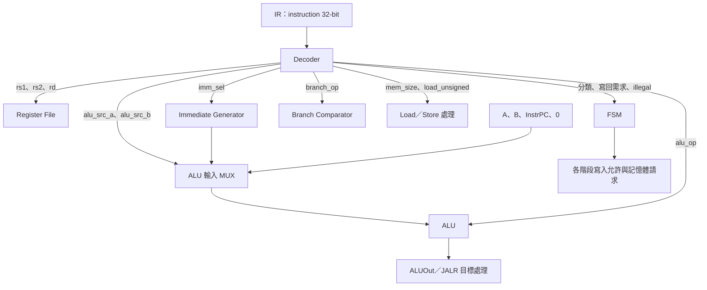

# Fault-V｜Week 5：Instruction Decoder 完整整理

> **本份 Week 5 實作已於 2026-10-02 使用 Vivado 2022.2 XSim 驗證：33,943 次 Decoder 檢查與 33 個 Decoder／Immediate Generator／ALU 局部整合案例全部通過。更新 package 後的五組既有模組回歸測試也全部通過。**
>
> 驗證位置是另外建立的 Week 5 資料夾；你原本的 Downloads/fault-V 專案沒有被修改。將本份檔案加入原 Vivado 專案後，可依後面的步驟重現。

**① 本週目標與每日對應**

| 日期 | 工作 | 本份文件的產出 |
| --- | --- | --- |
| Day 1 | 規格、介面、型別 | 欄位表、輸出規格、更新的 package |
| Day 2 | R-type／I-type | 10 種暫存器運算、9 種立即數運算的解碼 |
| Day 3 | LUI／AUIPC／Branch／Jump | PC 相對運算、六種分支、兩種跳躍 |
| Day 4 | Load／Store | 五種 Load、三種 Store、存取大小與擴展控制 |
| Day 5 | 特殊指令與非法編碼 | FENCE、ECALL、EBREAK、安全預設值 |
| Day 6 | Decoder 驗證 | 完整 tb_decoder、預期值表與實際結果 |
| Day 7 | 局部整合與回歸 | 完整 tb_decode_path、既有測試回歸與 Week 6 接口 |

以下 RTL 是 Day 1～7 合併後的最終版，直接使用即可。

---

**② Decoder 規格**

| 項目 | 決定 |
| --- | --- |
| 模組名稱 | `decoder` |
| 電路種類 | 組合邏輯，不含 clock、reset 或保存狀態的暫存器 |
| 指令輸入 | IR 保存的 `instruction[31:0]` |
| 執行分類 | 運算、Load、Store、Branch、JAL、JALR、FENCE、ECALL、EBREAK |
| 基本指令數 | 本專案辨識 40 種基本指令名稱 |
| 欄位輸出 | 固定擷取 rs1、rs2、rd 編號 |
| 控制輸出 | ALU 操作、立即數格式、輸入選擇、分支種類、存取寬度、寫回需求 |
| 非法／不支援編碼 | illegal＝1，控制資訊清回安全預設值 |
| 實際 clock 控制 | 由 Week 6 FSM 產生 reg_we、pc_we、mem_req 等訊號 |
| 擴充範圍 | 本版未啟用 M／C／CSR／FENCE.I 或自訂指令解碼 |

Decoder 把「這條指令需要做什麼」告訴 FSM。以 LW 為例，Decoder 指出需要讀記憶體與寫回，但 FSM 要等記憶體回應完成後才允許寫入 Register File。

ECALL／EBREAK 的分類是合法的；Fault-V 的執行環境讓 FSM 停止並記錄各自原因。這是已定義的自訂停止介面，標準 machine-mode trap／CSR 尚待另外實作。

---

**③ 指令欄位**

| 名稱 | 位元 | 寬度 | 用途 |
| --- | --- | --- | --- |
| opcode | [6:0] | 7 | 主要類別 |
| rd | [11:7] | 5 | 目的暫存器欄位 |
| funct3 | [14:12] | 3 | 類別內的功能選擇 |
| rs1 | [19:15] | 5 | 第一來源暫存器欄位 |
| rs2 | [24:20] | 5 | 第二來源暫存器欄位 |
| funct7 | [31:25] | 7 | R-type 與移位立即數的功能選擇 |

並非每個格式都使用所有欄位。ADDI 的 [24:20] 是立即數的一部分；Store 的 [11:7] 是立即數的一部分。Decoder 仍固定輸出編號，資料路徑與寫回控制決定是否使用。

例：`addi x5,x6,-4`＝`0xFFC30293`，rs1_addr＝6、rd_addr＝5；固定擷取出的 rs2_addr＝28，在這條指令中不參與運算。

---

**④ 模組介面**

所有名稱中的型別皆位於 `fault_v_pkg`。下表型別為 SystemVerilog。

| 訊號 | 方向 | 型別／寬度 | 意義 |
| --- | --- | --- | --- |
| instruction | input | logic [31:0] | IR 的完整指令 |
| rs1_addr | output | logic [4:0] | 第一來源編號 |
| rs2_addr | output | logic [4:0] | 第二來源編號 |
| rd_addr | output | logic [4:0] | 目的編號 |
| instr_class | output | instr_class_t／4-bit | FSM 路徑分類 |
| alu_op | output | alu_op_t／4-bit | 現有 ALU 的操作 |
| imm_sel | output | imm_sel_t／3-bit | 現有立即數產生器的格式 |
| alu_src_a | output | alu_src_a_t／2-bit | A／InstrPC／0 |
| alu_src_b | output | alu_src_b_t／1-bit | B／imm |
| branch_op | output | branch_op_t／3-bit | 比較 A、B 的方式 |
| mem_size | output | mem_size_t／2-bit | byte／halfword／word |
| load_unsigned | output | logic／1-bit | LBU／LHU 為 1；其他為 0 |
| rd_write | output | logic／1-bit | 指令的寫回需求 |
| wb_sel | output | wb_sel_t／2-bit | ALUOut／Load 結果／InstrPC＋4 |
| illegal | output | logic／1-bit | 1＝非法或未支援 |

`ALU_A_PC` 指的是 **InstrPC**。使用目前指令自己的位址來計算 AUIPC、分支與 JAL。

Load／Store 與 JALR 的分類已包含在 instr_class，因此不另外輸出重複的 mem_read、mem_write 或 is_jalr。

`rd_write` 是需求資訊。合法 ADD／Load／Jump 的 rd＝x0 時仍保留原分類與 rd_write＝1；Register File 忽略 x0 寫入。Load 到 x0 仍需執行存取和錯誤檢查。

---

**⑤ 架構與責任邊界**



| Decoder 負責 | 後續模組負責 |
| --- | --- |
| 指令是否合法、屬於哪一類 | FSM 選擇狀態與停止路徑 |
| 選擇 ALU 操作與輸入來源 | MUX 接線、ALU 運算、ALUOut 保存 |
| 選擇立即數格式 | imm_gen 擷取與符號擴展 |
| 選擇分支比較種類 | branch_cmp 比較 A、B，BranchTaken 保存結果 |
| 選擇存取大小與 Load 擴展 | 地址對齊檢查、byte enable、資料擷取／擴展 |
| 指出返回位址寫回 | Jump Commit 檢查目標、更新 PC 與 rd |

---

**⑥ 完整共用定義：fault_v_pkg.sv**

本檔包含原有 ALU／IMM 編碼，數值維持一致，並加入 Week 5 型別。以這份替換專案中唯一的一份 package；同名 package 不可重複加入。其他模組若共用此檔，應指向同一份來源。

```systemverilog
`timescale 1ns/1ps
package fault_v_pkg;
    typedef enum logic [3:0] {
        ALU_ADD=4'd0, ALU_SUB=4'd1, ALU_AND=4'd2, ALU_OR=4'd3,
        ALU_XOR=4'd4, ALU_SLL=4'd5, ALU_SRL=4'd6, ALU_SRA=4'd7,
        ALU_SLT=4'd8, ALU_SLTU=4'd9
    } alu_op_t;
    typedef enum logic [2:0] {
        IMM_NONE=3'd0, IMM_I=3'd1, IMM_S=3'd2,
        IMM_B=3'd3, IMM_U=3'd4, IMM_J=3'd5
    } imm_sel_t;
    typedef enum logic [3:0] {
        IC_INVALID=4'd0, IC_ALU=4'd1, IC_LOAD=4'd2, IC_STORE=4'd3,
        IC_BRANCH=4'd4, IC_JAL=4'd5, IC_JALR=4'd6,
        IC_FENCE=4'd7, IC_ECALL=4'd8, IC_EBREAK=4'd9
    } instr_class_t;
    typedef enum logic [1:0] {
        ALU_A_REG=2'd0, ALU_A_PC=2'd1, ALU_A_ZERO=2'd2
    } alu_src_a_t;
    typedef enum logic { ALU_B_REG=1'b0, ALU_B_IMM=1'b1 } alu_src_b_t;
    typedef enum logic [2:0] {
        BR_NONE=3'd0, BR_EQ=3'd1, BR_NE=3'd2, BR_LT=3'd3,
        BR_GE=3'd4, BR_LTU=3'd5, BR_GEU=3'd6
    } branch_op_t;
    typedef enum logic [1:0] {
        MEM_BYTE=2'd0, MEM_HALF=2'd1, MEM_WORD=2'd2
    } mem_size_t;
    typedef enum logic [1:0] {
        WB_ALU=2'd0, WB_LOAD=2'd1, WB_PC4=2'd2
    } wb_sel_t;
endpackage
```

---

**⑦ 控制編碼速查**

| 型別 | 名稱與編碼 |
| --- | --- |
| instr_class_t | INVALID＝0、ALU＝1、LOAD＝2、STORE＝3、BRANCH＝4、JAL＝5、JALR＝6、FENCE＝7、ECALL＝8、EBREAK＝9 |
| alu_src_a_t | REG＝0、PC＝1、ZERO＝2 |
| alu_src_b_t | REG＝0、IMM＝1 |
| branch_op_t | NONE＝0、EQ＝1、NE＝2、LT＝3、GE＝4、LTU＝5、GEU＝6 |
| mem_size_t | BYTE＝0、HALF＝1、WORD＝2 |
| wb_sel_t | ALU＝0、LOAD＝1、PC4＝2 |

這些都是 CPU 內部控制值，機器指令的 opcode 在下一節。

---

**⑧ 指令編碼與控制總表**

下表 funct3 為二進位，funct7／opcode 為十六進位。「—」表示該欄是立即數的一部分或不使用；不能拿它來限制指令。

| 指令 | opcode | funct3 | funct7／額外條件 | ALU／控制動作 |
| --- | --- | --- | --- | --- |
| ADD | 33 | 000 | 00 | ALU_ADD |
| SUB | 33 | 000 | 20 | ALU_SUB |
| SLL | 33 | 001 | 00 | ALU_SLL |
| SLT | 33 | 010 | 00 | ALU_SLT |
| SLTU | 33 | 011 | 00 | ALU_SLTU |
| XOR | 33 | 100 | 00 | ALU_XOR |
| SRL | 33 | 101 | 00 | ALU_SRL |
| SRA | 33 | 101 | 20 | ALU_SRA |
| OR | 33 | 110 | 00 | ALU_OR |
| AND | 33 | 111 | 00 | ALU_AND |
| ADDI | 13 | 000 | — | ALU_ADD |
| SLTI | 13 | 010 | — | ALU_SLT |
| SLTIU | 13 | 011 | — | ALU_SLTU |
| XORI | 13 | 100 | — | ALU_XOR |
| ORI | 13 | 110 | — | ALU_OR |
| ANDI | 13 | 111 | — | ALU_AND |
| SLLI | 13 | 001 | 00 | ALU_SLL |
| SRLI | 13 | 101 | 00 | ALU_SRL |
| SRAI | 13 | 101 | 20 | ALU_SRA |
| LUI | 37 | — | — | 0＋U-type imm |
| AUIPC | 17 | — | — | InstrPC＋U-type imm |
| BEQ | 63 | 000 | — | BR_EQ |
| BNE | 63 | 001 | — | BR_NE |
| BLT | 63 | 100 | — | BR_LT |
| BGE | 63 | 101 | — | BR_GE |
| BLTU | 63 | 110 | — | BR_LTU |
| BGEU | 63 | 111 | — | BR_GEU |
| JAL | 6F | — | — | PC-relative 目標、PC＋4 寫回 |
| JALR | 67 | 000 | — | A＋imm、清 bit 0、PC＋4 寫回 |
| LB | 03 | 000 | — | byte、符號擴展 |
| LH | 03 | 001 | — | halfword、符號擴展 |
| LW | 03 | 010 | — | word、原值 |
| LBU | 03 | 100 | — | byte、零擴展 |
| LHU | 03 | 101 | — | halfword、零擴展 |
| SB | 23 | 000 | — | byte 寫入 |
| SH | 23 | 001 | — | halfword 寫入 |
| SW | 23 | 010 | — | word 寫入 |
| FENCE | 0F | 000 | 忽略 fm、pred、succ、rs1、rd | 保守排序 |
| ECALL | 73 | 000 | 完整指令必須＝00000073 | 分類為 IC_ECALL |
| EBREAK | 73 | 000 | 完整指令必須＝00100073 | 分類為 IC_EBREAK |

---

**⑨ Day 2：R-type／I-type 的檢查規則**

| 項目 | 規則 |
| --- | --- |
| R-type | 檢查完整 funct7＋funct3 組合 |
| ADD／SUB | funct3 相同，funct7 不同 |
| SRL／SRA | funct3 相同，funct7 不同 |
| M 擴充乘除 | 本版未支援；不能把 MUL 誤當 ADD |
| 一般 I-type | 高 12-bit 全部作為立即數；不限制成 funct7＝0 |
| SLLI／SRLI／SRAI | 檢查 [31:25]，低 5-bit 作為 shamt |
| 移位量 | 一般移位由 ALU 取 b[4:0]；立即數移位由 ALU 取 imm[4:0] |

例如 `SRAI ... ,31` 的 imm_gen 原始輸出是 `0x0000041F`，其中 0x400 來自功能位元。ALU 取低 5-bit，所以實際移位量仍是 31。

---

**⑩ Day 3：位址運算與分支控制**

| 類別 | ALU 左／右來源 | 立即數 | 比較／寫回 |
| --- | --- | --- | --- |
| LUI | 0／imm | U | ALUOut 寫回 |
| AUIPC | InstrPC／imm | U | ALUOut 寫回 |
| Branch | InstrPC／imm | B | 另由 branch_op 指定比較 A、B 的方式 |
| JAL | InstrPC／imm | J | InstrPC＋4 作為返回位址 |
| JALR | A／imm | I | 原始結果清 bit 0；InstrPC＋4 作為返回位址 |
| branch_op | 成立條件 |
| --- | --- |
| BR_EQ | A＝B |
| BR_NE | A≠B |
| BR_LT | signed A＜B |
| BR_GE | signed A≥B |
| BR_LTU | unsigned A＜B |
| BR_GEU | unsigned A≥B |

B／J 立即數已包含最低位 0，目標加法直接使用 imm，不可再左移一次。分支成立與否、目標對齊和錯誤停止仍由外部控制處理。

---

**⑪ Day 4：記憶體控制**

| 指令 | instr_class | imm_sel | mem_size | load_unsigned | rd_write | wb_sel |
| --- | --- | --- | --- | --- | --- | --- |
| LB | LOAD | I | BYTE | 0 | 1 | LOAD |
| LH | LOAD | I | HALF | 0 | 1 | LOAD |
| LW | LOAD | I | WORD | 0 | 1 | LOAD |
| LBU | LOAD | I | BYTE | 1 | 1 | LOAD |
| LHU | LOAD | I | HALF | 1 | 1 | LOAD |
| SB | STORE | S | BYTE | 0 | 0 | 不使用 |
| SH | STORE | S | HALF | 0 | 0 | 不使用 |
| SW | STORE | S | WORD | 0 | 0 | 不使用 |

這八種指令皆用 A＋imm 計算有效位址。mem_size 的二位元值代表存取大小，真正的四位元 mem_wstrb 需結合有效位址低位，交由 Store 對齊邏輯產生。

LW 的 load_unsigned＝0 不會改變 32-bit 原始讀回值；Load 擴展單元要依 mem_size 決定處理方式。

---

**⑫ Day 5：特殊指令與非法編碼**

| 情況 | Decoder 行為 | FSM 後續行為 |
| --- | --- | --- |
| FENCE | IC_FENCE、illegal＝0、不寫回 | 確認先前存取已完成，再完成指令 |
| ECALL | IC_ECALL、illegal＝0 | 保存既定停止原因 |
| EBREAK | IC_EBREAK、illegal＝0 | 保存既定停止原因 |
| CSR、MRET、WFI | IC_INVALID、illegal＝1 | 非法／不支援停止 |
| FENCE.I | IC_INVALID、illegal＝1 | 未啟用此擴充 |
| M／RV64／C／自訂指令 | IC_INVALID、illegal＝1 | 本版未支援 |
| 畸形 ECALL／EBREAK | IC_INVALID、illegal＝1 | 不能只看 immediate 就接受 |

FENCE 忽略 fm、pred、succ、rs1、rd，採較保守的全部存取排序；FENCE.TSO 與保留配置亦走同一路徑。這符合基本實作對保留欄位的處理要求。實際排序成立還依賴記憶體完成回應代表哪些操作已完成的系統約定。[RISC-V 官方 RV32I 規範：Memory Ordering Instructions](https://docs.riscv.org/reference/isa/v20260120/unpriv/rv32.html#_memory_ordering_instructions)

本版所有存取依序完成、沒有寫入緩衝；FSM 的 FENCE_COMMIT 必須維持這項前提。

---

**⑬ 非法指令的安全預設值**

| 訊號 | 值 |
| --- | --- |
| illegal | 1 |
| instr_class | IC_INVALID |
| alu_op | ALU_ADD |
| imm_sel | IMM_NONE |
| alu_src_a／alu_src_b | ALU_A_ZERO／ALU_B_IMM |
| branch_op | BR_NONE |
| mem_size | MEM_WORD |
| load_unsigned／rd_write | 0／0 |
| wb_sel | WB_ALU |

非法指令的 ALU 輸入成為 0＋0。預設 mem_size＝WORD 只是欄位值，沒有任何存取請求。RTL 最後統一清除非法指令的部分解碼，避免出現 illegal＝1 但 rd_write 仍為 1 的矛盾。

---

**⑭ 完整 RTL：decoder.sv**

```systemverilog
`timescale 1ns/1ps
module decoder (
    input logic [31:0] instruction,
    output logic [4:0] rs1_addr, rs2_addr, rd_addr,
    output fault_v_pkg::instr_class_t instr_class,
    output fault_v_pkg::alu_op_t alu_op,
    output fault_v_pkg::imm_sel_t imm_sel,
    output fault_v_pkg::alu_src_a_t alu_src_a,
    output fault_v_pkg::alu_src_b_t alu_src_b,
    output fault_v_pkg::branch_op_t branch_op,
    output fault_v_pkg::mem_size_t mem_size,
    output logic load_unsigned, rd_write,
    output fault_v_pkg::wb_sel_t wb_sel,
    output logic illegal
);
    import fault_v_pkg::*;
    logic [6:0] opcode, funct7;
    logic [2:0] funct3;
    assign opcode = instruction[6:0];
    assign funct3 = instruction[14:12];
    assign funct7 = instruction[31:25];
    assign rs1_addr = instruction[19:15];
    assign rs2_addr = instruction[24:20];
    assign rd_addr = instruction[11:7];

    always_comb begin
        instr_class = IC_INVALID;
        alu_op = ALU_ADD;
        imm_sel = IMM_NONE;
        alu_src_a = ALU_A_ZERO;
        alu_src_b = ALU_B_IMM;
        branch_op = BR_NONE;
        mem_size = MEM_WORD;
        load_unsigned = 1'b0;
        rd_write = 1'b0;
        wb_sel = WB_ALU;
        illegal = 1'b1;

        case (opcode)
            7'h33: begin // Register-register integer operations
                instr_class = IC_ALU;
                alu_src_a = ALU_A_REG;
                alu_src_b = ALU_B_REG;
                rd_write = 1'b1;
                case ({funct7, funct3})
                    10'b0000000_000: begin alu_op=ALU_ADD;  illegal=0; end
                    10'b0100000_000: begin alu_op=ALU_SUB;  illegal=0; end
                    10'b0000000_001: begin alu_op=ALU_SLL;  illegal=0; end
                    10'b0000000_010: begin alu_op=ALU_SLT;  illegal=0; end
                    10'b0000000_011: begin alu_op=ALU_SLTU; illegal=0; end
                    10'b0000000_100: begin alu_op=ALU_XOR;  illegal=0; end
                    10'b0000000_101: begin alu_op=ALU_SRL;  illegal=0; end
                    10'b0100000_101: begin alu_op=ALU_SRA;  illegal=0; end
                    10'b0000000_110: begin alu_op=ALU_OR;   illegal=0; end
                    10'b0000000_111: begin alu_op=ALU_AND;  illegal=0; end
                    default: begin end
                endcase
            end
            7'h13: begin // Register-immediate integer operations
                instr_class = IC_ALU;
                alu_src_a = ALU_A_REG;
                imm_sel = IMM_I;
                rd_write = 1'b1;
                case (funct3)
                    3'b000: begin alu_op=ALU_ADD;  illegal=0; end
                    3'b010: begin alu_op=ALU_SLT;  illegal=0; end
                    3'b011: begin alu_op=ALU_SLTU; illegal=0; end
                    3'b100: begin alu_op=ALU_XOR;  illegal=0; end
                    3'b110: begin alu_op=ALU_OR;   illegal=0; end
                    3'b111: begin alu_op=ALU_AND;  illegal=0; end
                    3'b001: begin
                        if (funct7 == 7'h00) begin alu_op=ALU_SLL; illegal=0; end
                    end
                    3'b101: begin
                        if (funct7 == 7'h00) begin alu_op=ALU_SRL; illegal=0; end
                        else if (funct7 == 7'h20) begin alu_op=ALU_SRA; illegal=0; end
                    end
                    default: begin end
                endcase
            end
            7'h37: begin // LUI
                instr_class=IC_ALU; imm_sel=IMM_U;
                rd_write=1; illegal=0;
            end
            7'h17: begin // AUIPC
                instr_class=IC_ALU; imm_sel=IMM_U; alu_src_a=ALU_A_PC;
                rd_write=1; illegal=0;
            end
            7'h63: begin // Conditional branches
                instr_class=IC_BRANCH; imm_sel=IMM_B; alu_src_a=ALU_A_PC;
                case (funct3)
                    3'b000: begin branch_op=BR_EQ;  illegal=0; end
                    3'b001: begin branch_op=BR_NE;  illegal=0; end
                    3'b100: begin branch_op=BR_LT;  illegal=0; end
                    3'b101: begin branch_op=BR_GE;  illegal=0; end
                    3'b110: begin branch_op=BR_LTU; illegal=0; end
                    3'b111: begin branch_op=BR_GEU; illegal=0; end
                    default: begin end
                endcase
            end
            7'h6f: begin // JAL
                instr_class=IC_JAL; imm_sel=IMM_J; alu_src_a=ALU_A_PC;
                rd_write=1; wb_sel=WB_PC4; illegal=0;
            end
            7'h67: begin // JALR
                if (funct3 == 3'b000) begin
                    instr_class=IC_JALR; imm_sel=IMM_I; alu_src_a=ALU_A_REG;
                    rd_write=1; wb_sel=WB_PC4; illegal=0;
                end
            end
            7'h03: begin // Loads
                instr_class=IC_LOAD; imm_sel=IMM_I; alu_src_a=ALU_A_REG;
                rd_write=1; wb_sel=WB_LOAD;
                case (funct3)
                    3'b000: begin mem_size=MEM_BYTE; illegal=0; end
                    3'b001: begin mem_size=MEM_HALF; illegal=0; end
                    3'b010: begin mem_size=MEM_WORD; illegal=0; end
                    3'b100: begin mem_size=MEM_BYTE; load_unsigned=1; illegal=0; end
                    3'b101: begin mem_size=MEM_HALF; load_unsigned=1; illegal=0; end
                    default: begin end
                endcase
            end
            7'h23: begin // Stores
                instr_class=IC_STORE; imm_sel=IMM_S; alu_src_a=ALU_A_REG;
                case (funct3)
                    3'b000: begin mem_size=MEM_BYTE; illegal=0; end
                    3'b001: begin mem_size=MEM_HALF; illegal=0; end
                    3'b010: begin mem_size=MEM_WORD; illegal=0; end
                    default: begin end
                endcase
            end
            7'h0f: begin
                // Conservative FENCE: ignore fm, pred, succ, rs1 and rd.
                // FENCE.I (funct3=001) is not implemented.
                if (funct3 == 3'b000) begin instr_class=IC_FENCE; illegal=0; end
            end
            7'h73: begin
                // Exact encodings: do not accept malformed SYSTEM instructions.
                if (instruction == 32'h00000073) begin
                    instr_class=IC_ECALL; illegal=0;
                end else if (instruction == 32'h00100073) begin
                    instr_class=IC_EBREAK; illegal=0;
                end
            end
            default: begin end
        endcase

        // Remove all partially decoded controls on an illegal instruction.
        if (illegal) begin
            instr_class=IC_INVALID; alu_op=ALU_ADD; imm_sel=IMM_NONE;
            alu_src_a=ALU_A_ZERO; alu_src_b=ALU_B_IMM; branch_op=BR_NONE;
            mem_size=MEM_WORD; load_unsigned=0; rd_write=0; wb_sel=WB_ALU;
        end
    end
endmodule
```

---

**⑮ Day 6：Decoder 測試方法**

每次提供一條指令，等待 1 ns，核對全部控制輸出以及三個暫存器欄位。1 ns 是模擬檢查間隔，與綜合後延遲無關。

測試預期值來自書面編碼表及固定常數，沒有呼叫 DUT 來產生自己的答案。

Testbench 把控制訊號串成 24-bit，便於一次比較與輸出。位元配置如下：

| 位元 | 訊號 |
| --- | --- |
| [23:20] | instr_class |
| [19:16] | alu_op |
| [15:13] | imm_sel |
| [12:11] | alu_src_a |
| [10] | alu_src_b |
| [9:7] | branch_op |
| [6:5] | mem_size |
| [4] | load_unsigned |
| [3] | rd_write |
| [2:1] | wb_sel |
| [0] | illegal |

例如 ADD 的 `controls=100048` 表示 ALU 類、ADD、A／B、需要寫回且合法。安全預設值是 `001441`。這個 24-bit 串接值只在 testbench 使用，沒有新增 RTL 模組埠。

---

**⑯ 完整 Testbench：tb_decoder.sv**

```systemverilog
module tb_decoder;
    timeunit 1ns;
    timeprecision 1ps;
    import fault_v_pkg::*;
    logic [31:0] instruction;
    logic [4:0] rs1_addr, rs2_addr, rd_addr;
    instr_class_t instr_class;
    alu_op_t alu_op;
    imm_sel_t imm_sel;
    alu_src_a_t alu_src_a;
    alu_src_b_t alu_src_b;
    branch_op_t branch_op;
    mem_size_t mem_size;
    logic load_unsigned, rd_write, illegal;
    wb_sel_t wb_sel;
    decoder dut (
        .instruction(instruction),
        .rs1_addr(rs1_addr), .rs2_addr(rs2_addr), .rd_addr(rd_addr),
        .instr_class(instr_class), .alu_op(alu_op), .imm_sel(imm_sel),
        .alu_src_a(alu_src_a), .alu_src_b(alu_src_b), .branch_op(branch_op),
        .mem_size(mem_size), .load_unsigned(load_unsigned),
        .rd_write(rd_write), .wb_sel(wb_sel), .illegal(illegal)
    );

    int test_count=0;
    bit verbose=1;
    localparam logic [23:0] SAFE=24'h001441;
    logic [23:0] golden;
    logic [31:0] word_value;
    logic [4:0] expected_rs2;
    integer f7,f3,sh,im,r,fm;

    // Golden controls are constants from the written test specification.
    // Order: class, alu, imm, src_a, src_b, branch, size, unsigned, write, wb, illegal.
    task automatic check(input string label_text,
                         input logic [31:0] inst,
                         input logic [23:0] expected);
        logic [23:0] observed;
        instruction=inst;
        #1;
        observed={instr_class,alu_op,imm_sel,alu_src_a,alu_src_b,
                  branch_op,mem_size,load_unsigned,rd_write,wb_sel,illegal};
        if (observed !== expected)
            $fatal(1,"FAIL %s inst=%h controls=%h expected=%h",label_text,inst,observed,expected);
        if ((rs1_addr !== inst[19:15]) || (rs2_addr !== inst[24:20]) || (rd_addr !== inst[11:7]))
            $fatal(1,"FAIL %s register fields rs1=%0d rs2=%0d rd=%0d",label_text,rs1_addr,rs2_addr,rd_addr);
        test_count++;
        if (verbose) $display("PASS %0d: %s inst=%h controls=%h",test_count,label_text,inst,observed);
    endtask

    initial begin
        check("ADD",32'h007302b3,24'h100048);
        check("SUB",32'h407302b3,24'h110048);
        check("SLL",32'h007312b3,24'h150048);
        check("SLT",32'h007322b3,24'h180048);
        check("SLTU",32'h007332b3,24'h190048);
        check("XOR",32'h007342b3,24'h140048);
        check("SRL",32'h007352b3,24'h160048);
        check("SRA",32'h407352b3,24'h170048);
        check("OR",32'h007362b3,24'h130048);
        check("AND",32'h007372b3,24'h120048);
        check("ADDI",32'hffc30293,24'h102448);
        check("SLTI",32'hffc32293,24'h182448);
        check("SLTIU",32'hffc33293,24'h192448);
        check("XORI",32'hffc34293,24'h142448);
        check("ORI",32'hffc36293,24'h132448);
        check("ANDI",32'hffc37293,24'h122448);
        check("SLLI",32'h01f31293,24'h152448);
        check("SRLI",32'h01f35293,24'h162448);
        check("SRAI",32'h41f35293,24'h172448);
        check("LUI",32'h123452b7,24'h109448);
        check("AUIPC",32'h12345297,24'h108c48);
        check("BEQ",32'hfe730ee3,24'h406cc0);
        check("BNE",32'hfe731ee3,24'h406d40);
        check("BLT",32'hfe734ee3,24'h406dc0);
        check("BGE",32'hfe735ee3,24'h406e40);
        check("BLTU",32'hfe736ee3,24'h406ec0);
        check("BGEU",32'hfe737ee3,24'h406f40);
        check("JAL",32'hffdff2ef,24'h50ac4c);
        check("JALR",32'hffc302e7,24'h60244c);
        check("LB",32'hffc30283,24'h20240a);
        check("LH",32'hffc31283,24'h20242a);
        check("LW",32'hffc32283,24'h20244a);
        check("LBU",32'hffc34283,24'h20241a);
        check("LHU",32'hffc35283,24'h20243a);
        check("SB",32'hfe730e23,24'h304400);
        check("SH",32'hfe731e23,24'h304420);
        check("SW",32'hfe732e23,24'h304440);
        check("FENCE",32'h0ff0000f,24'h701440);
        check("ECALL",32'h00000073,24'h801440);
        check("EBREAK",32'h00100073,24'h901440);
        verbose=0;

        // All 128 funct7 values x all eight funct3 values for opcode 0x33.
        for (f7=0; f7<128; f7++) begin
            for (f3=0; f3<8; f3++) begin
                golden=SAFE;
                case ({f7[6:0],f3[2:0]})
                    10'h000: golden=24'h100048;
                    10'h100: golden=24'h110048;
                    10'h001: golden=24'h150048;
                    10'h002: golden=24'h180048;
                    10'h003: golden=24'h190048;
                    10'h004: golden=24'h140048;
                    10'h005: golden=24'h160048;
                    10'h105: golden=24'h170048;
                    10'h006: golden=24'h130048;
                    10'h007: golden=24'h120048;
                    default: begin end
                endcase
                word_value={f7[6:0],5'd7,5'd6,f3[2:0],5'd5,7'h33};
                check("R encoding sweep",word_value,golden);
            end
        end

        // RV32 immediate shifts: all upper seven bits and all 32 shift amounts.
        for (f7=0; f7<128; f7++) begin
            for (sh=0; sh<32; sh++) begin
                golden=SAFE;
                if (f7==0) golden=24'h152448;
                check("SLLI encoding sweep",{f7[6:0],sh[4:0],5'd6,3'b001,5'd5,7'h13},golden);
                golden=SAFE;
                if (f7==0) golden=24'h162448;
                else if (f7==32) golden=24'h172448;
                check("SRLI/SRAI encoding sweep",{f7[6:0],sh[4:0],5'd6,3'b101,5'd5,7'h13},golden);
            end
        end

        // No funct7 restriction on the six non-shift I-type operations.
        for (im=0; im<4096; im++) begin
            check("ADDI immediate sweep",{im[11:0],5'd6,3'd0,5'd5,7'h13},24'h102448);
            check("SLTI immediate sweep",{im[11:0],5'd6,3'd2,5'd5,7'h13},24'h182448);
            check("SLTIU immediate sweep",{im[11:0],5'd6,3'd3,5'd5,7'h13},24'h192448);
            check("XORI immediate sweep",{im[11:0],5'd6,3'd4,5'd5,7'h13},24'h142448);
            check("ORI immediate sweep",{im[11:0],5'd6,3'd6,5'd5,7'h13},24'h132448);
            check("ANDI immediate sweep",{im[11:0],5'd6,3'd7,5'd5,7'h13},24'h122448);
        end

        // All register numbers; independent numeric expected field checks.
        for (r=0; r<32; r++) begin
            expected_rs2=5'd31-r[4:0];
            word_value={7'b0,expected_rs2,r[4:0],3'b000,r[4:0],7'h33};
            check("register field sweep",word_value,24'h100048);
            if ((rs1_addr !== r[4:0]) || (rs2_addr !== expected_rs2) || (rd_addr !== r[4:0]))
                $fatal(1,"FAIL independent register field check r=%0d",r);
        end

        // Visit every funct3 of memory, branch, JALR and MISC-MEM opcodes.
        for (f3=0; f3<8; f3++) begin
            golden=SAFE;
            case (f3)
                0: golden=24'h20240a;
                1: golden=24'h20242a;
                2: golden=24'h20244a;
                4: golden=24'h20241a;
                5: golden=24'h20243a;
                default: begin end
            endcase
            check("load funct3 sweep",{12'hffc,5'd6,f3[2:0],5'd5,7'h03},golden);
            golden=SAFE;
            case (f3)
                0: golden=24'h304400;
                1: golden=24'h304420;
                2: golden=24'h304440;
                default: begin end
            endcase
            check("store funct3 sweep",{12'hffc,5'd6,f3[2:0],5'd5,7'h23},golden);
            golden=SAFE;
            case (f3)
                0: golden=24'h406cc0;
                1: golden=24'h406d40;
                4: golden=24'h406dc0;
                5: golden=24'h406e40;
                6: golden=24'h406ec0;
                7: golden=24'h406f40;
                default: begin end
            endcase
            check("branch funct3 sweep",{12'hffc,5'd6,f3[2:0],5'd5,7'h63},golden);
            golden=SAFE;
            case (f3)
                0: golden=24'h60244c;
                default: begin end
            endcase
            check("jalr funct3 sweep",{12'hffc,5'd6,f3[2:0],5'd5,7'h67},golden);
            golden=SAFE;
            case (f3)
                0: golden=24'h701440;
                default: begin end
            endcase
            check("fence funct3 sweep",{12'hffc,5'd6,f3[2:0],5'd5,7'h0f},golden);
        end

        // FENCE ignores all reserved fm values and nonzero rs1/rd.
        for (fm=0; fm<16; fm++) begin
            check("FENCE reserved fields",{fm[3:0],8'hff,5'd31,3'b000,5'd31,7'h0f},24'h701440);
        end

        verbose=1;
        check("all zeros",32'h00000000,SAFE);
        check("all ones",32'hffffffff,SAFE);
        check("MUL unsupported",32'h027302b3,SAFE);
        check("FENCE.I unsupported",32'h0000100f,SAFE);
        check("CSRRW unsupported",32'h300312f3,SAFE);
        check("CSRRS unsupported",32'h300322f3,SAFE);
        check("MRET unsupported",32'h30200073,SAFE);
        check("WFI unsupported",32'h10500073,SAFE);
        check("ECALL nonzero rd",32'h000000f3,SAFE);
        check("ECALL nonzero rs1",32'h00080073,SAFE);
        check("EBREAK nonzero rd",32'h001000f3,SAFE);
        check("EBREAK nonzero rs1",32'h00108073,SAFE);
        check("unknown SYSTEM immediate",32'h00200073,SAFE);
        check("RV64 OP-IMM-32",32'h0003029b,SAFE);
        check("RV64 OP-32",32'h007302bb,SAFE);
        check("compressed encoding",32'h00000001,SAFE);
        check("custom not yet implemented",32'h0073028b,SAFE);
        check("canonical NOP",32'h00000013,24'h102448);
        check("load to x0 retains load",32'h00032003,24'h20244a);
        check("jump to x0 retains jump",32'h0040006f,24'h50ac4c);
        // Interleave invalid and valid instructions to expose stale controls.
        check("invalid after jump",32'hffffffff,SAFE);
        check("valid ADD after invalid",32'h007302b3,24'h100048);
        check("invalid after ADD",32'h027302b3,SAFE);
        $display("ALL %0d DECODER CHECKS PASSED",test_count);
        $finish;
    end
    initial begin
        #100000;
        $fatal(1,"TIMEOUT tb_decoder");
    end
endmodule
```

---

**⑰ 40 條基本指令的預期／實際控制值**

下表 controls 為前述 24-bit 測試串接值；所有數值均為十六進位。本次 XSim 結果與預期一致。

| 編號 | 指令 | instruction | controls | 狀態 |
| --- | --- | --- | --- | --- |
| 1 | ADD | `007302B3` | `100048` | PASS |
| 2 | SUB | `407302B3` | `110048` | PASS |
| 3 | SLL | `007312B3` | `150048` | PASS |
| 4 | SLT | `007322B3` | `180048` | PASS |
| 5 | SLTU | `007332B3` | `190048` | PASS |
| 6 | XOR | `007342B3` | `140048` | PASS |
| 7 | SRL | `007352B3` | `160048` | PASS |
| 8 | SRA | `407352B3` | `170048` | PASS |
| 9 | OR | `007362B3` | `130048` | PASS |
| 10 | AND | `007372B3` | `120048` | PASS |
| 11 | ADDI | `FFC30293` | `102448` | PASS |
| 12 | SLTI | `FFC32293` | `182448` | PASS |
| 13 | SLTIU | `FFC33293` | `192448` | PASS |
| 14 | XORI | `FFC34293` | `142448` | PASS |
| 15 | ORI | `FFC36293` | `132448` | PASS |
| 16 | ANDI | `FFC37293` | `122448` | PASS |
| 17 | SLLI | `01F31293` | `152448` | PASS |
| 18 | SRLI | `01F35293` | `162448` | PASS |
| 19 | SRAI | `41F35293` | `172448` | PASS |
| 20 | LUI | `123452B7` | `109448` | PASS |
| 21 | AUIPC | `12345297` | `108C48` | PASS |
| 22 | BEQ | `FE730EE3` | `406CC0` | PASS |
| 23 | BNE | `FE731EE3` | `406D40` | PASS |
| 24 | BLT | `FE734EE3` | `406DC0` | PASS |
| 25 | BGE | `FE735EE3` | `406E40` | PASS |
| 26 | BLTU | `FE736EE3` | `406EC0` | PASS |
| 27 | BGEU | `FE737EE3` | `406F40` | PASS |
| 28 | JAL | `FFDFF2EF` | `50AC4C` | PASS |
| 29 | JALR | `FFC302E7` | `60244C` | PASS |
| 30 | LB | `FFC30283` | `20240A` | PASS |
| 31 | LH | `FFC31283` | `20242A` | PASS |
| 32 | LW | `FFC32283` | `20244A` | PASS |
| 33 | LBU | `FFC34283` | `20241A` | PASS |
| 34 | LHU | `FFC35283` | `20243A` | PASS |
| 35 | SB | `FE730E23` | `304400` | PASS |
| 36 | SH | `FE731E23` | `304420` | PASS |
| 37 | SW | `FE732E23` | `304440` | PASS |
| 38 | FENCE | `0FF0000F` | `701440` | PASS |
| 39 | ECALL | `00000073` | `801440` | PASS |
| 40 | EBREAK | `00100073` | `901440` | PASS |

**⑱ 掃描測試與實際數量**

| 組別 | 次數 | 驗證內容 | 結果 |
| --- | --- | --- | --- |
| 40 條基本指令 | 40 | 每條的全部控制值 | PASS |
| R-type 編碼掃描 | 1,024 | 128 種 funct7 × 8 種 funct3 | PASS |
| 移位立即數掃描 | 8,192 | 128 種高位 × 32 種 shamt × 左／右移兩類 | PASS |
| 六種一般 I-type 立即數掃描 | 24,576 | 每種 4,096 個 12-bit 立即數 | PASS |
| 暫存器欄位掃描 | 32 | rs1／rs2／rd 涵蓋 0～31，附獨立編號檢查 | PASS |
| Load／Store／Branch／JALR／FENCE funct3 | 40 | 五類各八種功能值，含合法與非法 | PASS |
| FENCE 保留欄位 | 16 | 全部 fm 值，rs1／rd 非零 | PASS |
| 指定非法、x0、NOP 與切換案例 | 23 | 含非法後轉合法與合法後轉非法 | PASS |
| **合計** | **33,943** | 每次也檢查欄位擷取 | **全部通過** |

PASS 編號在第 40 筆後跳到 33921 是正常的：大量掃描案例關閉逐筆顯示，但仍逐筆檢查和計數，失敗仍立即 $fatal。

非法例子包括 MUL、FENCE.I、CSR、MRET、WFI、非零 rd／rs1 的 ECALL／EBREAK、不支援 SYSTEM immediate、RV64 opcode、壓縮與尚未啟用的 custom opcode。

指定 NOP 是 ADDI x0,x0,0；Load 到 x0 仍是 LOAD；JAL 到 x0 仍是 JAL。它們不能被誤判成非法或提前刪去必要動作。

---

**⑲ Day 7：局部整合驗證架構**

```text
instruction → Decoder → imm_sel → imm_gen → imm
                  │                         │
                  ├→ alu_src_a／alu_src_b → MUX
                  │                         │
A、B、InstrPC、0 ──────────────────────────→ MUX
                  │                         │
                  └→ alu_op ──────────────→ ALU
                                            │
                          result、JALR 清 bit 0 後的值
                                            │
                 rd_write＋wb_sel → 寫回候選值選擇
```

這組測試由 testbench 提供 A、B、InstrPC，串接真正的 Decoder、imm_gen、ALU；MUX 與 JALR 清 bit 0、寫回候選值邏輯在 testbench 中接線。

| 輸出觀察 | 意義 |
| --- | --- |
| imm | 立即數生成結果 |
| result | ALU 原始結果 |
| target | JALR 時清 bit 0 的結果；其他情況等於 result，僅供觀察 |
| wb | 具寫回需求時的候選值，ALU 結果或 InstrPC＋4 |

此處沒有記憶體讀回資料，因此 LW 的 wb 候選值用 0 佔位。測的是有效位址與解碼路徑；真正 Load 寫回要由 MDR 與 Load 擴展邏輯提供。

分支的條件比較、PC 真正更新、RF 寫入、存取握手與停止狀態將在完整資料路徑／FSM 整合時驗證。非法指令測試檢查安全組合值；停止行為依 Week 6 FSM 實作。

---

**⑳ 完整局部整合 Testbench：tb_decode_path.sv**

```systemverilog
module tb_decode_path;
    timeunit 1ns;
    timeprecision 1ps;
    import fault_v_pkg::*;
    logic [31:0] instruction;
    logic [4:0] rs1_addr, rs2_addr, rd_addr;
    instr_class_t instr_class;
    alu_op_t alu_op;
    imm_sel_t imm_sel;
    alu_src_a_t alu_src_a;
    alu_src_b_t alu_src_b;
    branch_op_t branch_op;
    mem_size_t mem_size;
    logic load_unsigned, rd_write, illegal;
    wb_sel_t wb_sel;
    decoder dut (
        .instruction(instruction),
        .rs1_addr(rs1_addr), .rs2_addr(rs2_addr), .rd_addr(rd_addr),
        .instr_class(instr_class), .alu_op(alu_op), .imm_sel(imm_sel),
        .alu_src_a(alu_src_a), .alu_src_b(alu_src_b), .branch_op(branch_op),
        .mem_size(mem_size), .load_unsigned(load_unsigned),
        .rd_write(rd_write), .wb_sel(wb_sel), .illegal(illegal)
    );

    logic [31:0] a_value,b_value,instr_pc,imm,alu_a,alu_b;
    logic [31:0] result,target_value,wb_candidate;
    int test_count=0;
    imm_gen u_imm(.instruction(instruction),.imm_sel(imm_sel),.imm(imm));
    alu u_alu(.a(alu_a),.b(alu_b),.alu_op(alu_op),.result(result));
    always_comb begin
        case (alu_src_a)
            ALU_A_REG: alu_a=a_value;
            ALU_A_PC: alu_a=instr_pc;
            default: alu_a=32'b0;
        endcase
        alu_b=(alu_src_b==ALU_B_REG)?b_value:imm;
        target_value=(instr_class==IC_JALR)?(result&32'hfffffffe):result;
        wb_candidate=32'b0;
        if (rd_write && !illegal) begin
            case (wb_sel)
                WB_ALU: wb_candidate=result;
                WB_PC4: wb_candidate=instr_pc+32'd4;
                default: wb_candidate=32'b0; // No memory return data in this test.
            endcase
        end
    end
    task automatic check(input string label_text,
                         input logic [31:0] inst,av,bv,ip,
                         input logic [31:0] expected_imm,expected_result,
                         input logic [31:0] expected_target,expected_wb);
        instruction=inst; a_value=av; b_value=bv; instr_pc=ip;
        #10;
        if ((imm !== expected_imm) || (result !== expected_result) ||
            (target_value !== expected_target) || (wb_candidate !== expected_wb))
            $fatal(1,"FAIL %s imm=%h/%h result=%h/%h target=%h/%h wb=%h/%h",label_text,imm,expected_imm,result,expected_result,target_value,expected_target,wb_candidate,expected_wb);
        test_count++;
        $display("PASS %0d: %s imm=%h result=%h target=%h wb=%h",test_count,label_text,imm,result,target_value,wb_candidate);
    endtask
    initial begin
        check("ADD",32'h007302b3,32'h00000005,32'h00000003,32'h00000100,32'h00000000,32'h00000008,32'h00000008,32'h00000008);
        check("SUB negative",32'h407302b3,32'h00000003,32'h00000005,32'h00000100,32'h00000000,32'hfffffffe,32'hfffffffe,32'hfffffffe);
        check("SLL mask",32'h007312b3,32'h00000001,32'h00000020,32'h00000100,32'h00000000,32'h00000001,32'h00000001,32'h00000001);
        check("SLT signed",32'h007322b3,32'hffffffff,32'h00000001,32'h00000100,32'h00000000,32'h00000001,32'h00000001,32'h00000001);
        check("SLTU unsigned",32'h007332b3,32'hffffffff,32'h00000001,32'h00000100,32'h00000000,32'h00000000,32'h00000000,32'h00000000);
        check("XOR",32'h007342b3,32'h0000000a,32'h0000000c,32'h00000100,32'h00000000,32'h00000006,32'h00000006,32'h00000006);
        check("SRL",32'h007352b3,32'h80000000,32'h00000001,32'h00000100,32'h00000000,32'h40000000,32'h40000000,32'h40000000);
        check("SRA",32'h407352b3,32'h80000000,32'h00000001,32'h00000100,32'h00000000,32'hc0000000,32'hc0000000,32'hc0000000);
        check("OR",32'h007362b3,32'h0000000a,32'h0000000c,32'h00000100,32'h00000000,32'h0000000e,32'h0000000e,32'h0000000e);
        check("AND",32'h007372b3,32'h0000000a,32'h0000000c,32'h00000100,32'h00000000,32'h00000008,32'h00000008,32'h00000008);
        check("ADDI negative",32'hffc30293,32'h0000000a,32'hdeadbeef,32'h00000100,32'hfffffffc,32'h00000006,32'h00000006,32'h00000006);
        check("SLTI signed",32'hffc32293,32'hfffffff8,32'h00000000,32'h00000100,32'hfffffffc,32'h00000001,32'h00000001,32'h00000001);
        check("SLTIU sign-extended immediate",32'hffc33293,32'h00000000,32'h00000000,32'h00000100,32'hfffffffc,32'h00000001,32'h00000001,32'h00000001);
        check("XORI negative",32'hffc34293,32'h12345678,32'h00000000,32'h00000100,32'hfffffffc,32'hedcba984,32'hedcba984,32'hedcba984);
        check("ORI negative",32'hffc36293,32'h12345678,32'h00000000,32'h00000100,32'hfffffffc,32'hfffffffc,32'hfffffffc,32'hfffffffc);
        check("ANDI negative",32'hffc37293,32'h1234567b,32'h00000000,32'h00000100,32'hfffffffc,32'h12345678,32'h12345678,32'h12345678);
        check("SLLI 31",32'h01f31293,32'h00000001,32'h00000000,32'h00000100,32'h0000001f,32'h80000000,32'h80000000,32'h80000000);
        check("SRLI 31",32'h01f35293,32'h80000000,32'h00000000,32'h00000100,32'h0000001f,32'h00000001,32'h00000001,32'h00000001);
        check("SRAI 31",32'h41f35293,32'h80000000,32'h00000000,32'h00000100,32'h0000041f,32'hffffffff,32'hffffffff,32'hffffffff);
        check("LUI",32'h123452b7,32'hdeadbeef,32'h00000000,32'h00000100,32'h12345000,32'h12345000,32'h12345000,32'h12345000);
        check("AUIPC",32'h12345297,32'hdeadbeef,32'h00000000,32'h00000100,32'h12345000,32'h12345100,32'h12345100,32'h12345100);
        check("Branch backward target",32'hfe730ee3,32'hdeadbeef,32'h00000000,32'h00000100,32'hfffffffc,32'h000000fc,32'h000000fc,32'h00000000);
        check("JAL target and link",32'hffdff2ef,32'h00000000,32'h00000000,32'h00000100,32'hfffffffc,32'h000000fc,32'h000000fc,32'h00000104);
        check("JALR clear bit zero",32'h000302e7,32'h00000101,32'h00000000,32'h00000100,32'h00000000,32'h00000101,32'h00000100,32'h00000104);
        check("JALR negative offset",32'hffc302e7,32'h00000200,32'h00000000,32'h00000100,32'hfffffffc,32'h000001fc,32'h000001fc,32'h00000104);
        check("LW effective address",32'hffc32283,32'h10000008,32'h00000000,32'h00000100,32'hfffffffc,32'h10000004,32'h10000004,32'h00000000);
        check("SW effective address",32'hfe732e23,32'h10000008,32'h12345678,32'h00000100,32'hfffffffc,32'h10000004,32'h10000004,32'h00000000);
        check("FENCE safe controls",32'h0ff0000f,32'hdeadbeef,32'hffffffff,32'h00000100,32'h00000000,32'h00000000,32'h00000000,32'h00000000);
        check("ECALL safe controls",32'h00000073,32'hdeadbeef,32'hffffffff,32'h00000100,32'h00000000,32'h00000000,32'h00000000,32'h00000000);
        check("EBREAK safe controls",32'h00100073,32'hdeadbeef,32'hffffffff,32'h00000100,32'h00000000,32'h00000000,32'h00000000,32'h00000000);
        check("Illegal safe controls",32'hffffffff,32'hdeadbeef,32'hffffffff,32'h00000100,32'h00000000,32'h00000000,32'h00000000,32'h00000000);
        check("ADDI after illegal",32'hffc30293,32'h0000000a,32'h00000000,32'h00000100,32'hfffffffc,32'h00000006,32'h00000006,32'h00000006);
        check("ADDI overflow wraps",32'h00130293,32'hffffffff,32'h00000000,32'h00000100,32'h00000001,32'h00000000,32'h00000000,32'h00000000);
        $display("ALL %0d DECODE PATH CASES PASSED",test_count);
        $finish;
    end
    initial begin
        #10000;
        $fatal(1,"TIMEOUT tb_decode_path");
    end
endmodule
```

---

**㉑ 33 個局部整合案例與預期／實際結果**

數值皆為十六進位，完整輸入 A、B、InstrPC 在 testbench 各筆 check 中。全部結果已用 XSim 核對。

| 編號 | 案例 | instruction | imm | result | target | wb | 狀態 |
| --- | --- | --- | --- | --- | --- | --- | --- |
| 1 | ADD | `007302B3` | `00000000` | `00000008` | `00000008` | `00000008` | PASS |
| 2 | SUB negative | `407302B3` | `00000000` | `FFFFFFFE` | `FFFFFFFE` | `FFFFFFFE` | PASS |
| 3 | SLL mask | `007312B3` | `00000000` | `00000001` | `00000001` | `00000001` | PASS |
| 4 | SLT signed | `007322B3` | `00000000` | `00000001` | `00000001` | `00000001` | PASS |
| 5 | SLTU unsigned | `007332B3` | `00000000` | `00000000` | `00000000` | `00000000` | PASS |
| 6 | XOR | `007342B3` | `00000000` | `00000006` | `00000006` | `00000006` | PASS |
| 7 | SRL | `007352B3` | `00000000` | `40000000` | `40000000` | `40000000` | PASS |
| 8 | SRA | `407352B3` | `00000000` | `C0000000` | `C0000000` | `C0000000` | PASS |
| 9 | OR | `007362B3` | `00000000` | `0000000E` | `0000000E` | `0000000E` | PASS |
| 10 | AND | `007372B3` | `00000000` | `00000008` | `00000008` | `00000008` | PASS |
| 11 | ADDI negative | `FFC30293` | `FFFFFFFC` | `00000006` | `00000006` | `00000006` | PASS |
| 12 | SLTI signed | `FFC32293` | `FFFFFFFC` | `00000001` | `00000001` | `00000001` | PASS |
| 13 | SLTIU sign-extended immediate | `FFC33293` | `FFFFFFFC` | `00000001` | `00000001` | `00000001` | PASS |
| 14 | XORI negative | `FFC34293` | `FFFFFFFC` | `EDCBA984` | `EDCBA984` | `EDCBA984` | PASS |
| 15 | ORI negative | `FFC36293` | `FFFFFFFC` | `FFFFFFFC` | `FFFFFFFC` | `FFFFFFFC` | PASS |
| 16 | ANDI negative | `FFC37293` | `FFFFFFFC` | `12345678` | `12345678` | `12345678` | PASS |
| 17 | SLLI 31 | `01F31293` | `0000001F` | `80000000` | `80000000` | `80000000` | PASS |
| 18 | SRLI 31 | `01F35293` | `0000001F` | `00000001` | `00000001` | `00000001` | PASS |
| 19 | SRAI 31 | `41F35293` | `0000041F` | `FFFFFFFF` | `FFFFFFFF` | `FFFFFFFF` | PASS |
| 20 | LUI | `123452B7` | `12345000` | `12345000` | `12345000` | `12345000` | PASS |
| 21 | AUIPC | `12345297` | `12345000` | `12345100` | `12345100` | `12345100` | PASS |
| 22 | Branch backward target | `FE730EE3` | `FFFFFFFC` | `000000FC` | `000000FC` | `00000000` | PASS |
| 23 | JAL target and link | `FFDFF2EF` | `FFFFFFFC` | `000000FC` | `000000FC` | `00000104` | PASS |
| 24 | JALR clear bit zero | `000302E7` | `00000000` | `00000101` | `00000100` | `00000104` | PASS |
| 25 | JALR negative offset | `FFC302E7` | `FFFFFFFC` | `000001FC` | `000001FC` | `00000104` | PASS |
| 26 | LW effective address | `FFC32283` | `FFFFFFFC` | `10000004` | `10000004` | `00000000` | PASS |
| 27 | SW effective address | `FE732E23` | `FFFFFFFC` | `10000004` | `10000004` | `00000000` | PASS |
| 28 | FENCE safe controls | `0FF0000F` | `00000000` | `00000000` | `00000000` | `00000000` | PASS |
| 29 | ECALL safe controls | `00000073` | `00000000` | `00000000` | `00000000` | `00000000` | PASS |
| 30 | EBREAK safe controls | `00100073` | `00000000` | `00000000` | `00000000` | `00000000` | PASS |
| 31 | Illegal safe controls | `FFFFFFFF` | `00000000` | `00000000` | `00000000` | `00000000` | PASS |
| 32 | ADDI after illegal | `FFC30293` | `FFFFFFFC` | `00000006` | `00000006` | `00000006` | PASS |
| 33 | ADDI overflow wraps | `00130293` | `00000001` | `00000000` | `00000000` | `00000000` | PASS |

SRAI 第 19 筆的 imm＝0000041F 是預期的 I-type 原始輸出；低 5-bit 是 31。第 24 筆 JALR 的原始 result＝101，清 bit 0 後 target＝100，返回位址則為 InstrPC＋4＝104。

---

**㉒ Vivado 檔案與模擬設定**

| 用途 | 檔案 | 加入位置 |
| --- | --- | --- |
| 共用型別 | fault_v_pkg.sv | Design Sources，僅一份 |
| 新模組 | decoder.sv | Design Sources |
| 既有模組 | alu.sv、imm_gen.sv | Design Sources，已有者沿用即可 |
| Decoder 測試 | tb_decoder.sv | Simulation Sources |
| 局部整合測試 | tb_decode_path.sv | Simulation Sources |

附帶 rtl/alu.sv 與 rtl/imm_gen.sv 保持既有功能和埠名，提供獨立重現用。原專案已有相同模組時，確認一致後沿用原檔，避免重複加入同名 module。

檔案皆為 **SystemVerilog**。package 在其他使用它的檔案之前編譯。模擬不需要 XDC 或實體板卡。

執行 Decoder 測試：

1. Close Simulation。
2. 在 Simulation Sources 的 tb_decoder 上按右鍵 → Set as Top。
3. Run Behavioral Simulation。
4. Tcl Console 輸入 `run all`。
5. 確認最後的完成訊息。

預期且本次已觀察到：

```text
ALL 33943 DECODER CHECKS PASSED
$finish called at time : 33943 ns
```

此測試需要 33,943 ns，預設 `run 1000ns` 只跑前面一部分。按 Run All 或使用 `run all` 才會走到完成訊息。

局部整合測試將 Simulation Top 改成 tb_decode_path，照同樣步驟操作。預期且本次已觀察到：

```text
ALL 33 DECODE PATH CASES PASSED
$finish called at time : 330 ns
```

首次編譯大量掃描 testbench 可能花較久；以最後完成訊息判斷驗證是否完成。

---

**㉓ 既有模組回歸與驗證紀錄**

更新 package 後，重新執行已有測試。本份附帶的 regfile／pc／pc_path 與對應 testbench 複製自你原本的檔案；原始 Downloads 資料夾保持原狀。RTL 補上 timescale 以支援獨立命令列模擬。

| 測試頂層 | 檢查／案例數 | 模擬結束時間 | 本次實際結果 |
| --- | --- | --- | --- |
| tb_decoder | 33,943 | 33,943 ns | PASS |
| tb_decode_path | 33 | 330 ns | PASS |
| tb_alu | 20 | 200 ns | PASS |
| tb_imm_gen | 21 | 210 ns | PASS |
| tb_regfile | 104 | 1,371 ns | PASS |
| tb_pc_reg | 17 | 146 ns | PASS |
| tb_pc_path | 13 | 660 ns | PASS |

驗證工具：Vivado 2022.2 XSim Behavioral Simulation。紀錄保存在隨附包的 logs/；以下是這次跑完後的摘要。

```text
ALL 33943 DECODER CHECKS PASSED
$finish called at time : 33943 ns
ALL 33 DECODE PATH CASES PASSED
$finish called at time : 330 ns
ALL 20 ALU TESTS PASSED
$finish called at time : 200 ns
ALL 21 IMM TESTS PASSED
$finish called at time : 210 ns
ALL 104 REGFILE CHECKS PASSED
$finish called at time : 1371 ns
ALL 17 PC CHECKS PASSED
$finish called at time : 146 ns
ALL 13 PC PATH CASES PASSED
$finish called at time : 660 ns
```

---

**㉔ Week 6 FSM 的銜接規則**

IR 在一條指令執行期間保持不變，因此 Decoder 的輸出亦保持穩定，FSM 可以在不同狀態使用這些資訊。A、B 在 Decode 階段保存，指令位址由 InstrPC 保存。

| Decoder 分類 | DECODE 後的 FSM 路徑 |
| --- | --- |
| IC_INVALID／illegal | 保存非法原因 → HALTED |
| IC_ALU | ALU_EXEC → ALU_WB |
| IC_LOAD | ADDR_EXEC → MEM_CHECK → LOAD_WAIT → LOAD_WB |
| IC_STORE | ADDR_EXEC → MEM_CHECK → STORE_WAIT |
| IC_BRANCH | BR_EXEC → BR_COMMIT |
| IC_JAL／IC_JALR | JUMP_EXEC → JUMP_COMMIT |
| IC_FENCE | FENCE_COMMIT |
| IC_ECALL／IC_EBREAK | 保存對應停止原因 → HALTED |
| 訊號 | 誰產生 | 使用規則 |
| --- | --- | --- |
| rd_write | Decoder | 指令有寫回需求 |
| reg_we／RF rd_we | FSM | 只在成功寫回／Jump Commit 階段啟用 |
| pc_we | FSM | 正常完成時更新；等待／錯誤時保持 |
| mem_req | FSM／記憶體請求控制 | 只在合法存取且對齊檢查通過後發出，避免重複交易 |
| aluout_we | FSM | 正確 Execute 狀態結束時保存結果 |
| branch_taken_we | FSM | BR_EXEC 結束時保存比較結果 |
| mdr_we | FSM | Load 成功回應時保存 |

Jump Commit 若目標未對齊，不能更新 PC 或寫入返回位址。Branch 不成立時使用 InstrPC＋4，未採用的目標不觸發對齊錯誤。Load 到 x0 的存取仍須正常完成或報錯。

Week 6 的錯誤原因編碼沿用 W2：非法＝1、指令位址未對齊＝2、取指失敗＝3、Load 未對齊＝4、Store 未對齊＝5、Load 失敗＝6、Store 失敗＝7、ECALL＝8、EBREAK＝9。

---

**㉕ Week 5 驗收與完成紀錄**

| 驗收項目 | 狀態 | 證據／限制 |
| --- | --- | --- |
| 規格與模組介面 | 完成 | 本文件與 package |
| 40 種指令的 Decoder | 完成 | 每條固定指令向量檢查全部控制值 |
| 高位功能檢查與非法預設 | 通過本輪驗證 | R-type／移位掃描與指定非法案例 |
| 立即數位元不誤當功能限制 | 通過本輪驗證 | 六種一般 I-type 各 4,096 個立即數 |
| 不使用的控制值與連續切換 | 通過本輪驗證 | 安全預設與合法／非法交替案例 |
| Decoder＋imm_gen＋ALU 局部整合 | 通過 | 33 個固定預期結果案例 |
| 既有模組回歸 | 通過 | 五個既有 testbench 重新執行 |
| 完整多周期 CPU／FSM 行為 | 後續整合驗證 | 本週沒有實作完整 CPU 狀態控制 |
| 全部 2^32 指令字／形式驗證 | 尚未完成 | 本輪涵蓋上述明列範圍 |
| FPGA／ASIC 綜合與時序 | 後續階段 | 本次是 RTL 功能模擬 |

可保留的完成紀錄：

> **W5 完成：Instruction Decoder RTL、共用控制型別、規格文件與測試已完成。Vivado 2022.2 XSim 的 33,943 次解碼檢查及 33 個局部整合案例全部通過；ALU 20、IMM 21、Register File 104、PC 17、PC Path 13 的既有案例重新執行後仍全部通過。驗證範圍為本文件列出的模組與案例；完整 FSM 與 CPU 程式執行將在後續整合。**

---

**㉖ 隨附檔案與使用方式**

| 位置 | 內容 |
| --- | --- |
| Fault-V_Week5_Notion.md | 本文件，可匯入 Notion 或打開後複製 |
| rtl/ | package、decoder、局部整合所需既有模組 |
| verify/ | 兩個 Week 5 測試及五個既有回歸測試 |
| logs/ | 本次 XSim 執行結果 |
| run_xsim.ps1 | 命令列重現腳本，預設 Vivado 2022.2 |

Notion 可使用匯入 Markdown，或將文件內容複製至頁面。匯入後程式碼區塊、表格與章節都能繼續編輯。

你現在要在自己的專案重現時：替換唯一的 package → 加入 decoder 與兩個新 testbench → 分別執行 tb_decoder、tb_decode_path 的 Run All。其他 testbench 保留，依需要切換 Simulation Top。
