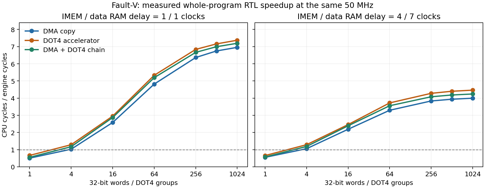

# Fault-V 延伸 C：驗證與效能報告

本報告記錄實際驗證證據；設計筆記另見 `Streaming_Architecture_Notion.md`。CPU 維持多周期及十二條自訂指令，新增 4 KiB scratchpad、word-copy DMA、獨立三階段 DOT4 向量加速器與三來源記憶體仲裁器。

## 模擬驗收

| 項目 | 實際結果 |
| --- | --- |
| DOT4 pipeline | 33,280 筆結果；全速與隨機背壓；4 次 reset flush；無背壓 II＝1、握手延遲＝3 clocks |
| 仲裁器 | 6,000 筆交易；CPU／DMA／ACC 各 2,000；請求／回應保持、錯誤路由、reset 取消 |
| SoC 整合 | 124 情境 × 2 記憶體延遲模式 × 3 次＝744 次；92 次執行中 reset 後以保留 RAM 重啟 |
| 故障與限制 | 長度、對齊、範圍、位址 wrap、buffer overlap、引擎衝突、CPU lock、busy 設定寫入、只讀／窄寫、DMA／ACC 讀寫錯誤及 tag 錯誤 |
| C 示範程式 | 137 項自檢；4 次正常執行及4次結果破壞；失敗編號65／134正確，成功UART為 C OK + CR/LF |
| Z2 wrapper | 3 次正常執行、18 UART bytes；ARM run 控制、BTN0 reset、LED與debug訊號 |
| 既有自訂運算單元 | 201,576 筆結果、26 次 reset 取消 |
| ISA／程式回歸 | 1,372 次 |
| 周邊／CPU周邊錯誤 | 16 筆周邊交易、8 個 CPU fault 情境 |
| Stress | 4 次程式執行、4,096 UART bytes、4 次中途 reset |
| 原本六種應用 | 408 次、136 次中途 reset；原本二進位指令數、交易數及 cycle 公式仍符合；另4次展示及4次故障注入 |

最終測試 log 的驗收標記全部存在且無 Fatal。Golden outputs 以 Python 整數運算產生；C 的非同步 DMA／ACC 沒有假借只支援原本 CPU 的 binary model 驗證。舊應用仍使用原有獨立 binary model。

同時工作情境：DMA 搬 256 words、ACC 計算64組DOT4、CPU執行200次獨立加一。快模式有776 clocks兩引擎同時busy，其中98次有用CPU加一在引擎busy時完成；慢模式分別為2321 clocks與200次。DMA512筆記憶體交易、ACC129筆、CPU2筆，結果全部正確。

## 效能量測

量測來源是 RTL simulation 的 clock 計数。比較同一SoC、相同輸入、相同50 MHz與相同記憶體延遲；包含整個程式的設定、啟動、輪詢、CPU loop、完成狀態寫入及停止成本。測試前由testbench裝載資料，不將該裝載時間算入程式；表中的CHAIN則把CPU或DMA搬移本身算入。

**DOT／CHAIN 的 CPU 基準已使用 DOT4ACC 自訂指令**；不是純RV32I乘法軟體。COPY的CPU基準使用LW／SW。硬體版本的控制成本完全算入，沒有宣稱所有資料量都加速。

| 工作 | N | 快模式CPU cycles | 快模式引擎 cycles | 加速比 | 慢模式CPU cycles | 慢模式引擎 cycles | 加速比 |
| --- | --- | --- | --- | --- | --- | --- | --- |
| 主RAM→scratchpad搬移 | 1 | 104 | 206 | 0.505× | 170 | 308 | 0.552× |
| 主RAM→scratchpad搬移 | 4 | 233 | 227 | 1.026× | 389 | 368 | 1.057× |
| 主RAM→scratchpad搬移 | 16 | 749 | 290 | 2.583× | 1265 | 578 | 2.189× |
| 主RAM→scratchpad搬移 | 64 | 2813 | 584 | 4.817× | 4769 | 1448 | 3.294× |
| 主RAM→scratchpad搬移 | 256 | 11069 | 1739 | 6.365× | 18785 | 4898 | 3.835× |
| 主RAM→scratchpad搬移 | 1024 | 44093 | 6338 | 6.957× | 74849 | 18728 | 3.997× |
| DOT4向量點積 | 1 | 141 | 212 | 0.665× | 228 | 347 | 0.657× |
| DOT4向量點積 | 4 | 300 | 233 | 1.288× | 486 | 377 | 1.289× |
| DOT4向量點積 | 16 | 936 | 317 | 2.953× | 1518 | 617 | 2.460× |
| DOT4向量點積 | 64 | 3480 | 653 | 5.329× | 5646 | 1517 | 3.722× |
| DOT4向量點積 | 256 | 13656 | 1997 | 6.838× | 22158 | 5177 | 4.280× |
| DOT4向量點積 | 1024 | 54360 | 7373 | 7.373× | 88206 | 19757 | 4.465× |
| 搬移後點積 | 1 | 214 | 387 | 0.553× | 346 | 603 | 0.574× |
| 搬移後點積 | 4 | 502 | 429 | 1.170× | 823 | 693 | 1.188× |
| 搬移後點積 | 16 | 1654 | 576 | 2.872× | 2731 | 1143 | 2.389× |
| 搬移後點積 | 64 | 6262 | 1206 | 5.192× | 10363 | 2913 | 3.558× |
| 搬移後點積 | 256 | 24694 | 3705 | 6.665× | 40891 | 10023 | 4.080× |
| 搬移後點積 | 1024 | 98422 | 13680 | 7.195× | 163003 | 38433 | 4.241× |

快模式IMEM／資料RAM回應延遲為1／1 clocks；慢模式為4／7 clocks。共84組比較，另涵蓋scratchpad→主RAM、主RAM→主RAM及scratchpad輸入DOT4。三次重跑的cycle數一致，詳見 `stream_benchmarks.csv` 及 `logs/stream_mode*.csv`。

三階段運算pipeline的II＝1不等於整機每拍一組DOT4；串行讀取A／B及共用記憶體仲裁是整機吞吐量限制。本測試未量測實體板上的benchmark counter、功耗或最高可用頻率。

## FPGA建置與成本

| 項目 | 延伸B平台 | 延伸C平台 |
| --- | --- | --- |
| LUT | 3402 | 5646 |
| FF | 2811 | 3669 |
| DSP | 4 | 8 |
| BRAM tiles | 8 | 9 |
| Clock | 50 MHz | 50 MHz |
| Setup WNS | 3.738 ns | 0.703 ns |
| Hold WHS | 0.030 ns | 0.025 ns |
| Pulse-width WPWS | 9.020 ns | 9.020 ns |

C多出一個scratchpad及四個加速器乘法器；上述資源是整個Z2平台，包括PS7與AXI周邊。Setup／Hold與pulse width均無負slack，methodology violations為0。

最終DRC無Error或Critical Warning，保留32個Warning：DPIP-1×16, DPOP-1×8, DPOP-2×8。DSP警告是DPIP／DPOP內部暫存器建議；運算pipeline使用外部暫存器，不代表DSP內建AREG／MREG／PREG已啟用。

Vivado建置的Critical Warning代碼：PSU-1, PSU-2。既有Z2 PS preset保留PSU-1／PSU-2的負DDR skew（−0.009／−0.033）；不執行ps7_init重設ARM DDR。這些不是Fault-V資料路徑的DRC失敗，仍保留在建置證據中。

LED與UART外部輸出沒有同步接收clock，約束使用false path；switch只對同步器第一級使用false path。因此此時序驗收不等於外部Pmod UART接線的電氣驗證。

## 實板與映像身分

PYNQ-Z2透過SSH／Ethernet載入最終映像，ARM讀取PL AXI UARTLite。三次均收到 `43 20 4F 4B 0D 0A`（C OK + CR/LF），總計18 bytes、UART error＝0、FCLK0＝50 MHz、debug＝0x1205（status1、halted、EBREAK原因9）。

使用者LED／BTN0觀察：已確認LD0／LD2亮，按住BTN0四燈熄滅，放開恢復。

Bitstream SHA-256：`b679ec3559f439127eb340853d49ad254937ebb6982480471faf836dcd537642`
HWH SHA-256：`a86cff8481d0866b7228fd9785ecac1d7c8acdc9a7b3bdb53c55ae19871dc218`

`fpga_identity.json`將映像與RTL、board wrapper、約束、ROM及Tcl綁定；`logs/build_sources_started.json`與建置完成來源相同。早期建置不列入交付驗收；曾在建置途中改ROM的版本由來源快照檢查拒絕。

## 限制與已修正問題

- 只提供word-copy DMA、單一工作描述與一筆仲裁後未完成交易；沒有descriptor ring、scatter/gather、中斷、cache coherency或AXI burst。
- CPU與引擎、兩引擎間的buffer所有權規則保守，來源只讀也鎖定；違規CPU存取直接停止。
- 已接受的記憶體寫入不保證在bus error／reset時回復。寫回錯誤案例刻意驗證RAM可能已變動而PROGRESS尚未增加。
- 發現並修正tag錯誤停止時可能留下已發出讀取的情形：先排空該response，再釋放BUSY及仲裁器，禁止結果寫入。
- 修正testbench的posedge驅動競態、XSim動態檔名字串、force/release殘值；示範程式修正UART ready輪詢；後期結果破壞測試等待新DMA工作的BUSY後再等待DONE，避免誤用上次sticky DONE。早期失敗log保留供追查。
- CPU／ISA相關15個原本RTL檔逐byte不變；原有檔案只有`fault_v_soc.sv`修改，新增6個RTL檔。
- FPGA功能、時序與資源驗收不等於ASIC sign-off；ASIC SRAM、標準元件、DFT、STA corners、DRC／LVS及交付規則仍屬後續工作。

重現入口與環境見README；完整原始碼、testbench、fixtures、腳本、bit／hwh及報告包含於ZIP。
